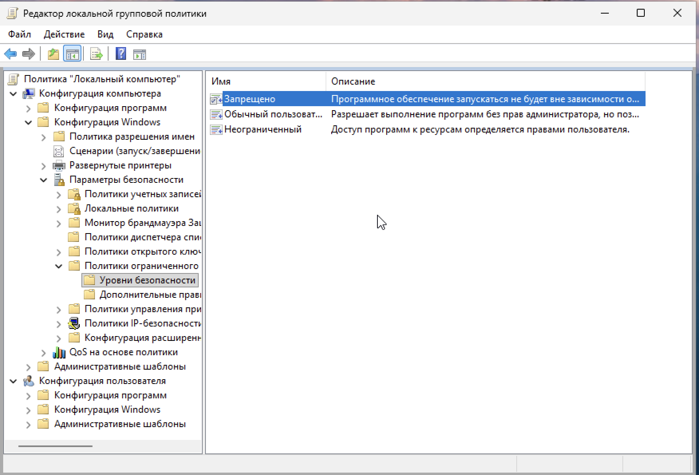
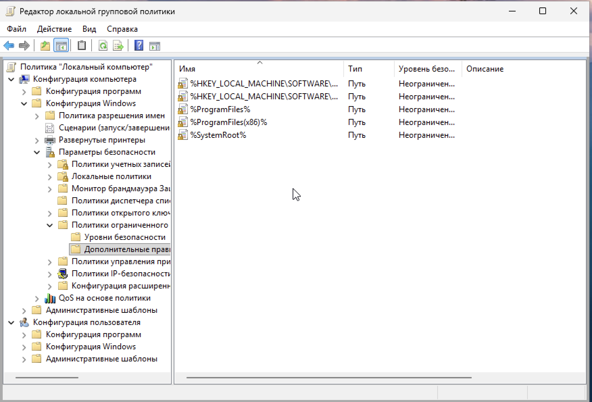
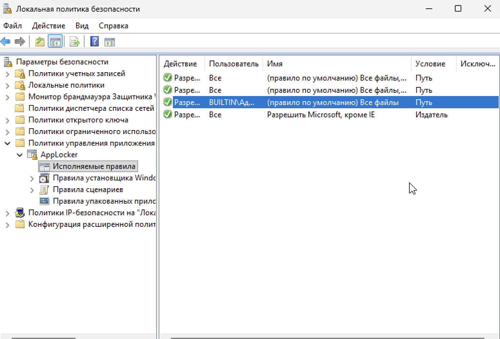
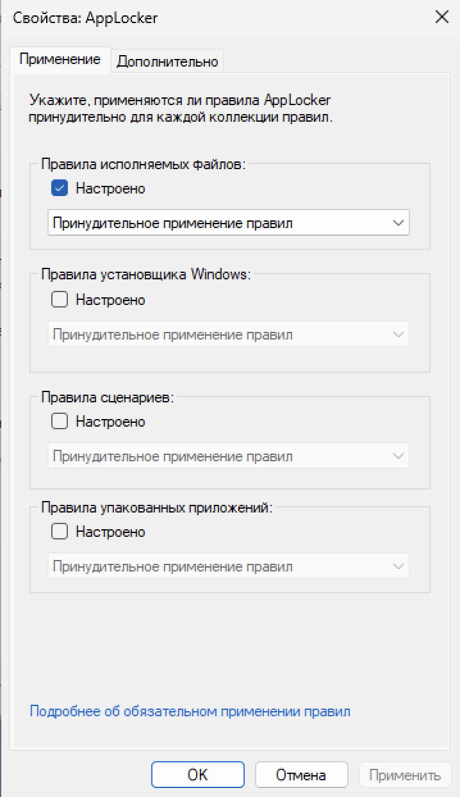
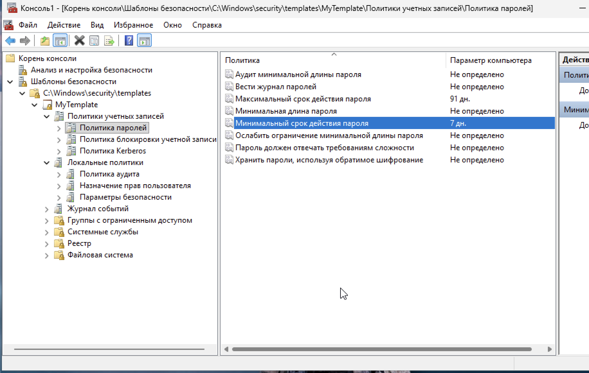
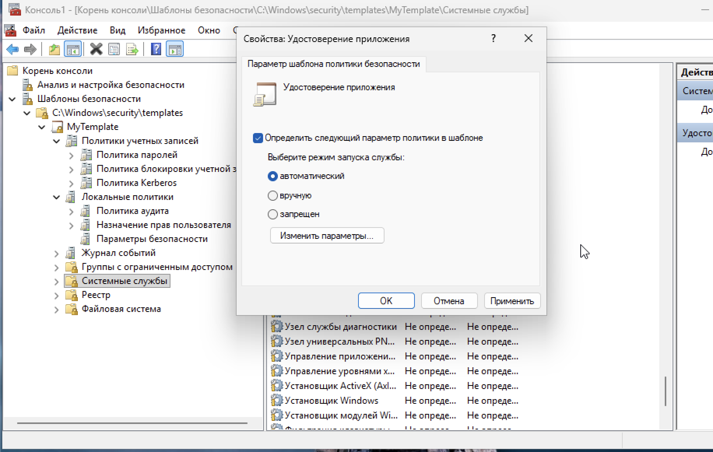
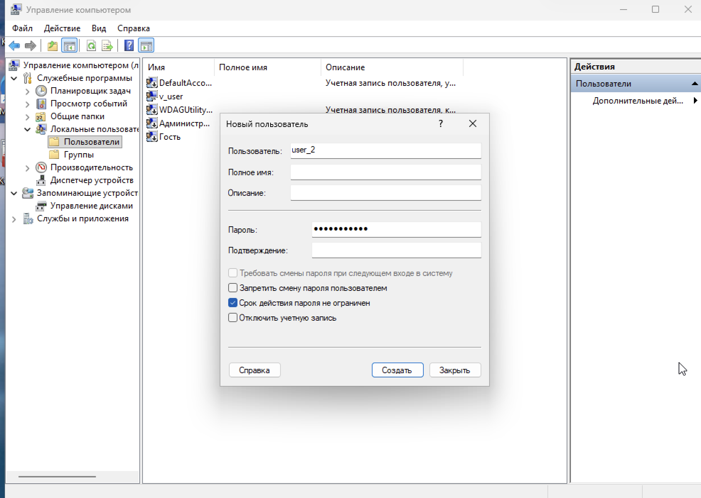
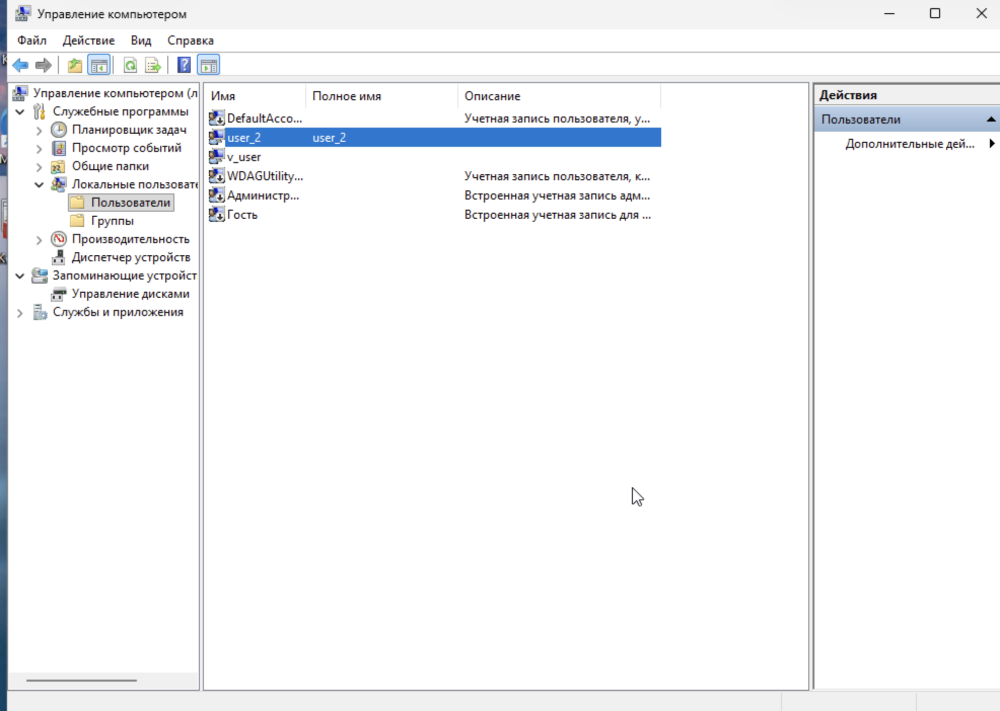
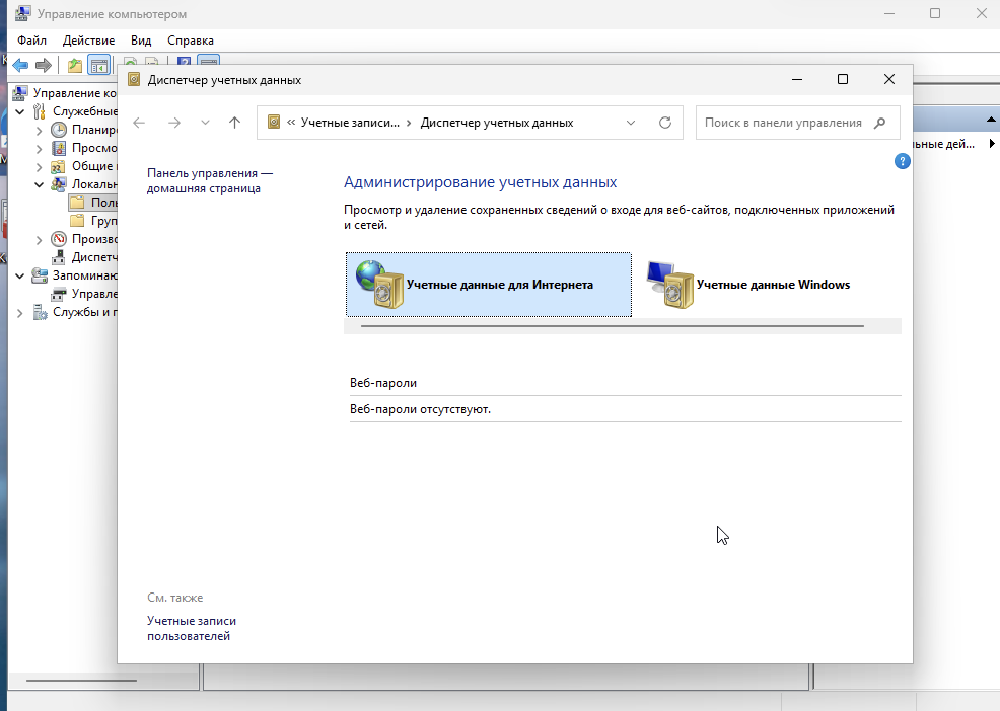
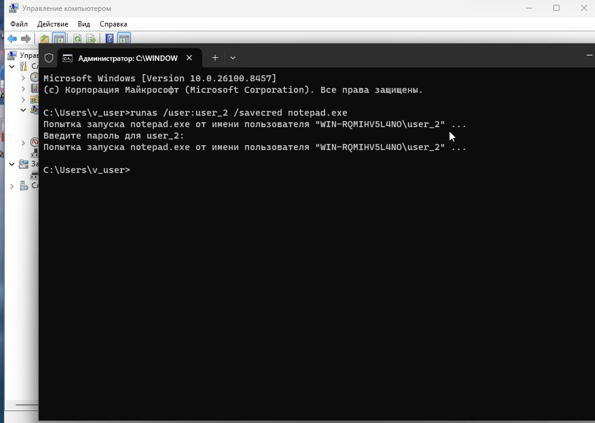

# Практическая работа: Администрирование параметров политики безопасности Windows

## 🎯 Цель работы
Получить навыки администрирования параметров политики безопасности ОС Windows: работа с диспетчером настройки безопасности, создание шаблона безопасности, настройка политик ограниченного использования программ (SRP), настройка правил AppLocker.

## 📋 Задание
1. Настроить и запустить Windows в VirtualBox.
2. Включить запрет запуска всех приложений, кроме системных папок и Program Files (SRP).
3. Проверить правило запуском EXE из папки «Загрузки».
4. Включить принудительное применение правил AppLocker.
5. Создать правило для файлов, подписанных Microsoft Corporation, с исключением для iexplore.exe.
6. Настроить собственный шаблон безопасности: мин. срок пароля — 7 дней, макс. — 91 день, автозагрузка службы «Удостоверение приложения».
7. Создать пользователя user_2 и проверить работу runas с ключами /savecred, /noprofile и без ключа.

## 🛠️ Использованные инструменты
- VirtualBox
- Редактор локальной групповой политики (gpedit.msc)
- Локальная политика безопасности (secpol.msc)
- Оснастка «Анализ и настройка безопасности»
- Оснастка «Шаблоны безопасности»
- Диспетчер учётных данных
- Командная строка (runas, notepad)

---

## 📸 Задание 1. Политики ограниченного использования программ (SRP)

### 1. Уровень безопасности «Запрещено»

В оснастке `gpedit.msc` → Конфигурация компьютера → Конфигурация Windows → Параметры безопасности → Политики ограниченного использования программ → Уровни безопасности установлено значение **«Запрещено»**.

Это значит: любое приложение, не подпадающее под разрешающие правила, будет блокировано.

### 2. Дополнительные правила SRP

В разделе «Дополнительные правила» добавлены пути, разрешающие запуск приложений из системных папок:

- `%HKEY_LOCAL_MACHINE\SOFTWARE\Microsoft\Windows\CurrentVersion\ProgramFilesDir%`
- `%ProgramFiles%`
- `%ProgramFiles(x86)%`
- `%SystemRoot%`

Все имеют уровень безопасности «Неограниченный».

### 3. Проверка правила

Скачан EXE-файл (Telegram) в папку «Загрузки». При попытке запуска появляется сообщение:

> **Это приложение заблокировано вашим системным администратором.**
> Для получения дополнительных сведений обратитесь к своему системному администратору.

Это подтверждает, что политика SRP работает: файлы из «Загрузок» (не входящие в разрешённые пути) блокируются.

---

## 📸 Задание 2. Правила AppLocker

### 4. Созданные правила AppLocker

В оснастке `secpol.msc` → Политики управления приложениями → AppLocker → Исполняемые правила созданы два правила:

- **Разрешить** для пользователя `BUILTIN\Администраторы` — «Все файлы, все пути».
- **Разрешить** для всех пользователей — «Microsoft, кроме IE» (по издателю).

### 5. Принудительное применение правил AppLocker

В свойствах AppLocker для «Правил исполняемых файлов» установлен режим **«Принудительное применение правил»**.

### Попытка запуска iexplore.exe

Так как для Internet Explorer создано исключение из правила «Microsoft, кроме IE», запуск `iexplore.exe` должен быть заблокирован. Однако в данной версии ОС (Windows 11 в VirtualBox) блокировка не сработала из-за особенностей поведения встроенного браузера — он заменён на Edge, а старый iexplore.exe отсутствует как отдельный компонент.

**Настройка выполнена корректно**, но фактическое поведение системы отличается от ожидаемого из-за версии ОС.

---

## 📸 Задание 3. Собственный шаблон безопасности

### 6. Папка templates в консоли

В оснастке «Анализ и настройка безопасности» открыта папка `C:\Windows\security\templates`.

### 7. Политика паролей

Создан собственный шаблон `MyTemplate`. В разделе «Политики учётных записей → Политика паролей» установлены значения:

- **Минимальный срок действия пароля:** 7 дней
- **Максимальный срок действия пароля:** 91 день

### 8. Автозагрузка службы «Удостоверение приложения»

В разделе «Системные службы» выбрана служба «Удостоверение приложения» (Application Identity). В свойствах установлен **автоматический режим запуска**.

Это необходимо для корректной работы правил AppLocker — служба отвечает за проверку цифровых подписей приложений.

Шаблон экспортирован на виртуальную машину в папку `C:\Windows\security\templates\MyTemplate`.

---

## 📸 Задание 4. Пользователь user_2 и runas

### 9. Диалог создания пользователя user_2

В оснастке «Управление компьютером» → «Локальные пользователи и группы» → «Пользователи» создана учётная запись **user_2** с паролем. Галочка «Требовать смены пароля при следующем входе» снята.

### 10. Пользователь user_2 в списке

В списке локальных пользователей появился **user_2**.

### 11. Диспетчер учётных данных — до запуска

Открыт «Диспетчер учётных данных» → «Учётные данные Windows». Список пуст — сохранённых учётных данных нет.

### 12. Запуск notepad.exe от имени user_2

Выполнена команда:

runas /user:user_2 /savecred notepad.exe

Каждый раз система запрашивает пароль пользователя user_2. Ключ `/savecred` не сохраняет учётные данные автоматически.

**Причина:** локальная политика безопасности Windows запрещает сохранение учётных данных для локальных пользователей. Это стандартное поведение для локальных учёток (не доменных).

Сама команда отработала корректно — Notepad успешно запускался.

### Сравнение запусков

Выполнены три запуска:
- `runas /user:user_2 /savecred notepad.exe` — требует ввод пароля
- `runas /user:user_2 /noprofile notepad.exe` — без загрузки профиля
- `runas /user:user_2 notepad.exe` — обычный запуск

**Разница в скорости:** заметной разницы не ощущается, блокнот открывается быстро во всех случаях. Это ожидаемо для простого приложения, не зависящего от профиля пользователя.

---

## 📊 Выводы
- Освоена настройка политик ограниченного использования программ (SRP).
- Изучены правила AppLocker и режим принудительного применения.
- Отработано создание собственного шаблона безопасности через оснастки ММС.
- Настроены политики паролей (минимальный и максимальный срок).
- Настроена автозагрузка службы «Удостоверение приложения».
- Создан пользователь user_2 и отработана команда `runas` с разными ключами.
- Выявлены особенности поведения ОС Windows 11 в VirtualBox (замена IE на Edge).
- Понят принцип работы локальных политик безопасности Windows.

## 🧠 Чему научился
- Работа с `gpedit.msc` и `secpol.msc`.
- Создание и применение правил SRP и AppLocker.
- Настройка шаблонов безопасности в оснастке «Анализ и настройка безопасности».
- Управление службами через шаблоны безопасности.
- Создание локальных пользователей через «Управление компьютером».
- Использование `runas` с ключами `/savecred`, `/noprofile` и без ключей.
- Понимание ограничений локальных политик для локальных пользователей.

## ⚠️ Особенности выполнения
- **Windows 11 в VirtualBox:** встроенный Internet Explorer заменён на Edge, поэтому фактический запуск iexplore.exe не удалось проверить. Правила AppLocker настроены корректно.
- **runas /savecred:** сохранение учётных данных не работает для локальных пользователей из-за политики безопасности Windows.
