# Практическая работа: Доменные групповые политики (GPO) и WSUS

## 🎯 Цель работы
Научиться работать с групповыми политиками Windows: настраивать среду пользователей, автоматизировать установку и удаление ПО, администрировать службу обновлений WSUS.

## 📋 Задание
1. Создать виртуальную сеть из сервера и клиента.
2. Создать домен example.org.
3. Создать пользователей user2, user3 с разными привилегиями.
4. Подключить клиента к домену.
5. Создать GPO Probe: скрыть область уведомлений, удалить закреплённые программы, отключить Store.
6. Установить и удалить MSI-пакет через GPO (назначенная установка).
7. Опубликовать MSI-пакет (публичная установка).
8. Установить и настроить WSUS.

## 🛠️ Использованные инструменты
- VirtualBox (сетевой мост)
- Active Directory — пользователи и компьютеры (dsa.msc)
- Управление групповой политикой (gpmc.msc)
- Редактор управления групповыми политиками
- WSUS (Update Services)
- gpresult, gpupdate

## 🌐 Схема сети

| Машина | IP-адрес | DNS | Шлюз | Адаптер |
|--------|----------|-----|------|---------|
| Сервер | 192.168.1.253/24 | 192.168.1.1 → 127.0.0.1 | 192.168.1.1 | Сетевой мост |
| Клиент | 192.168.1.252/24 | 192.168.1.253, 192.168.1.1 | — | Сетевой мост |

---

## 📸 Задание 1. Домен и пользователи

### 1. Компьютеры домена

В оснастке **Active Directory — пользователи и компьютеры** в контейнере `example.org → Computers` зарегистрирован компьютер **WIN-RQMIHV5L4NO**.

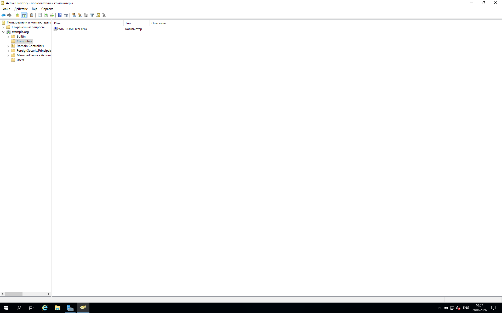

### 2. Пользователи и группы домена

В контейнере `example.org → Users` созданы:
- **user2** — обычный пользователь домена
- **user3** — пользователь домена + член группы «Администраторы» на контроллере домена

Также присутствуют группы: DnsAdmins, DnsUpdateProxy, Protected Users, WSUS Administrators, WSUS Reporters.

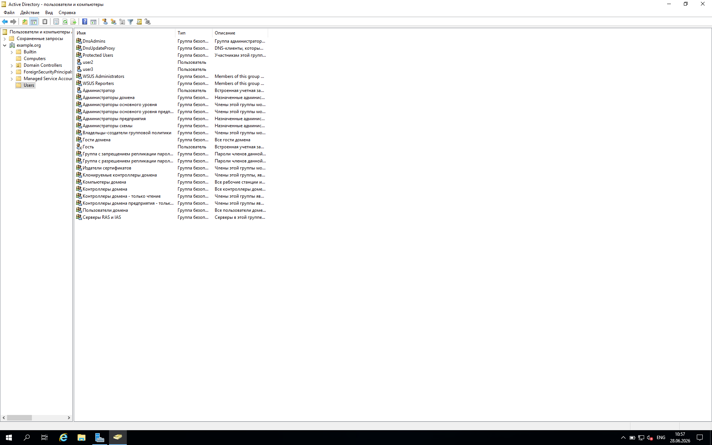

### 3. Свойства user3 — членство в группе

Открыты свойства user3 → вкладка «Член групп»: user3 входит в группы **Администраторы** (example\Builtin) и **Пользователи домена** (example.org\Users).

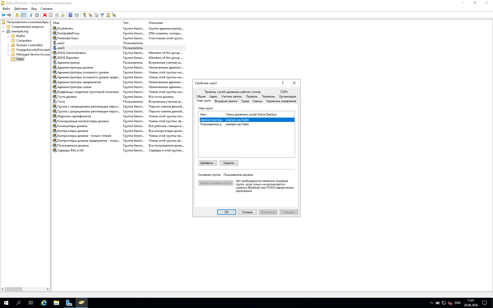

### 4. Присоединение к домену

Свойства системы клиента: полное имя — **WIN-RQMIHV5L4NO.example.org**, домен — **example.org**.

---

## 📸 Задание 2. GPO Probe — настройка среды пользователя

### 5. Фильтры безопасности GPO Probe

Для объекта групповой политики **Probe** заданы фильтры безопасности: применяется только для **user2** (user2@example.org) и **user3** (user3@example.org). Привязка — к домену example.org, принудительный — Нет, связь задействована — Да.

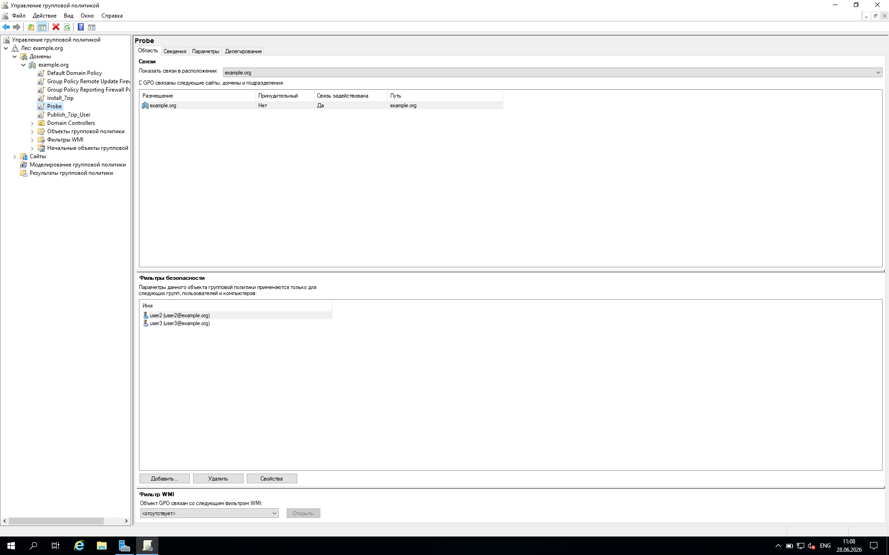

### 6. Удалить закреплённые программы с панели задач

Политика: **Конфигурация пользователя → Административные шаблоны → Меню «Пуск» и панель задач → Удалить закреплённые программы с панели задач** — **Включена**.

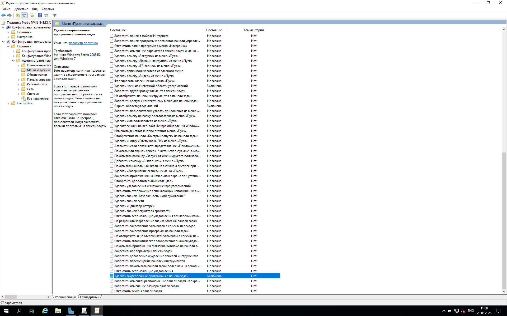

### 7. Скрыть область уведомлений

Политика: **Скрыть область уведомлений** — **Включена**.

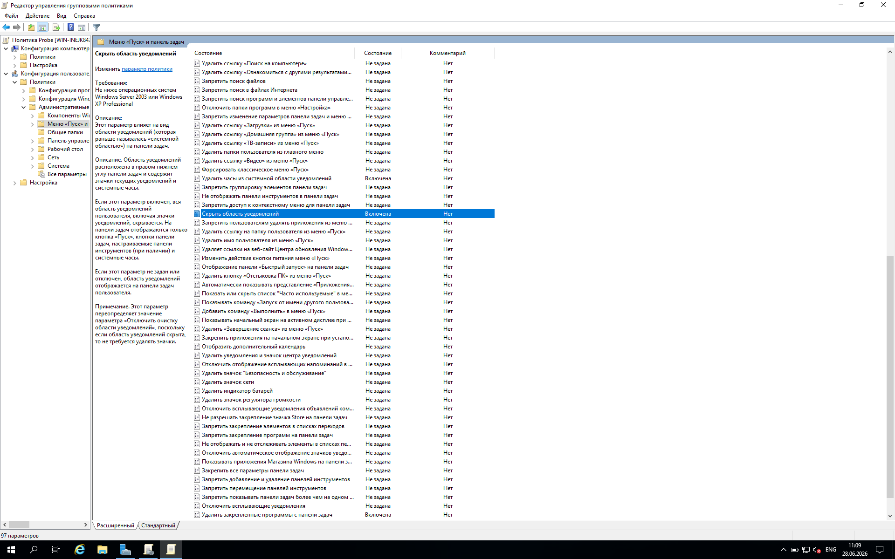

### 8. Удалить часы из системной области уведомлений

Политика: **Удалить часы из системной области уведомлений** — **Включена**.

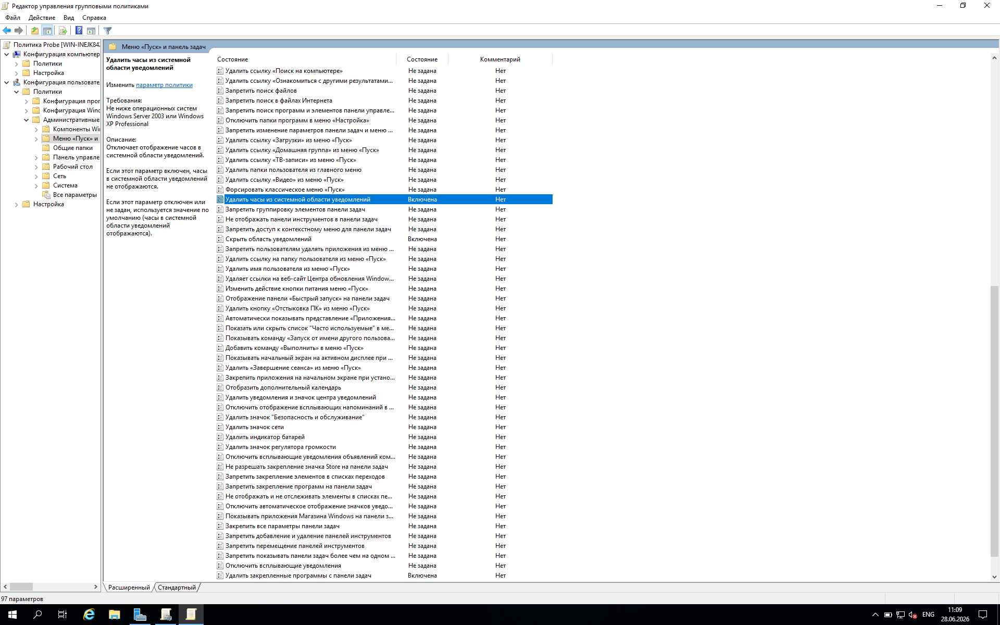

### 9. Отключить приложение Store

Политика: **Конфигурация компьютера → Административные шаблоны → Компоненты Windows → Магазин → Отключить приложение Store** — **Включена**.

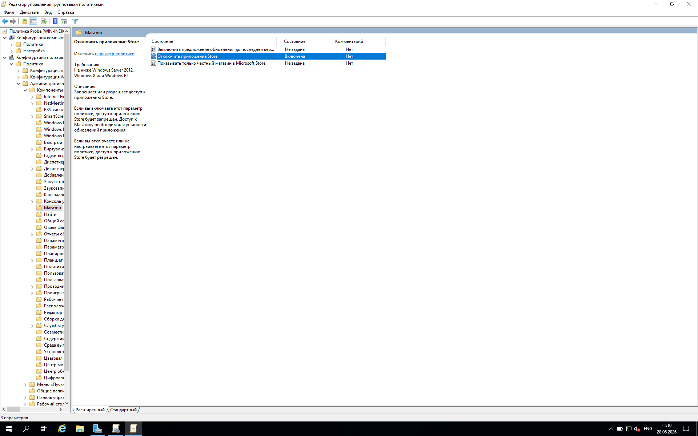

### 10. Общий вид настроек Probe

Сводный вид включённых политик GPO Probe.

### 11. Результат применения для user2

Рабочий стол user2 после применения GPO:
- Нет закреплённых программ на панели задач
- Скрыта область уведомлений
- Отсутствуют часы
- Отключён Microsoft Store

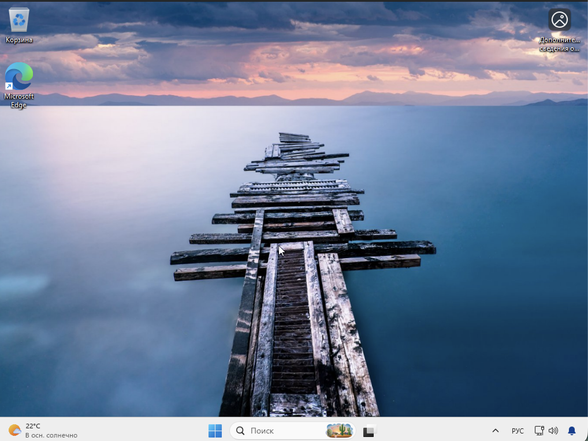

### 12. Проверка через gpresult

Вывод команды `gpresult`:
- Последнее применение групповой политики: 21.06.2026 в 16:41:33
- Групповая политика применена с: WIN-INEJK842BU3.example.org
- Применённые объекты: **Group Policy Reporting Firewall Ports**, **Probe**
- Отфильтрованные: Local Group Policy
- Пользователь входит в группы: Пользователи домена, Все, Пользователи, ИНТЕРАКТИВНЫЕ, КОНСОЛЬНЫЙ ВХОД и др.

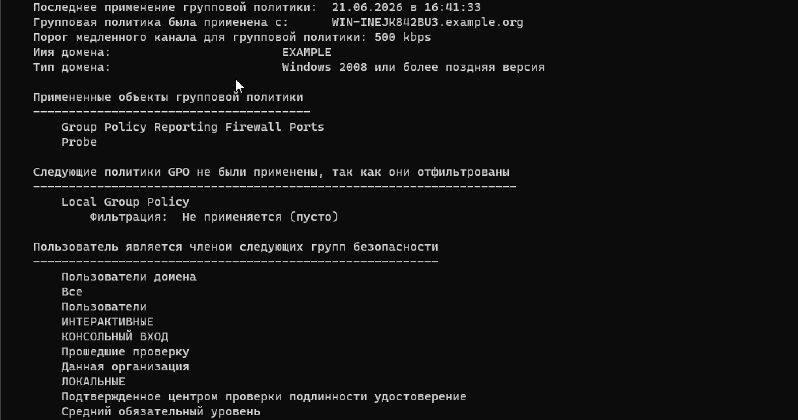

---

## 📸 Задание 3. Установка MSI через GPO (назначенная)

### 13. GPO Install_7zip — фильтры безопасности

GPO **Install_7zip** применяется для группы **Компьютеры домена (EXAMPLE\Компьютеры домена)**.

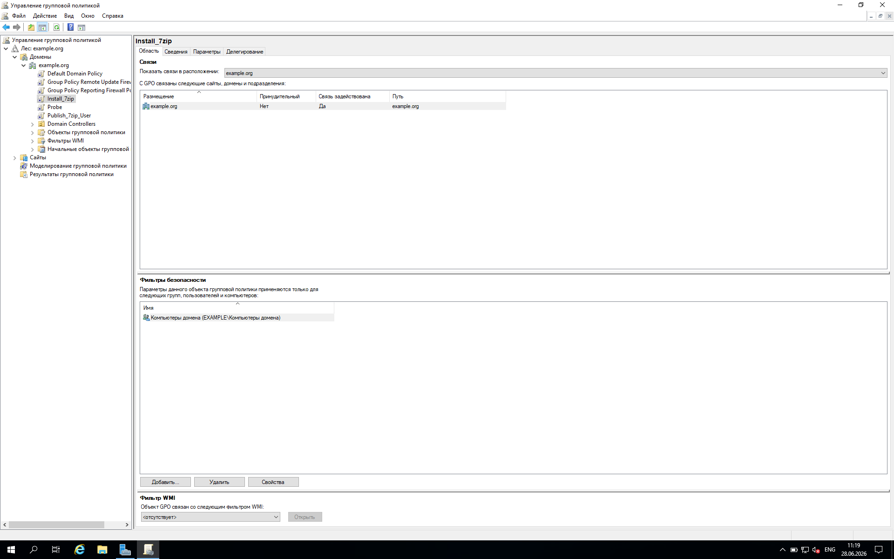

### 14. GPO Install_7zip — редактор

В редакторе: **Конфигурация компьютера → Политики → Конфигурация программ → Установка программ** добавлен пакет **7-Zip 24.09 (x64 edition)** с методом развёртывания **«Назначенный»**, источник — `C:\Software\7z2409-x64.msi`.

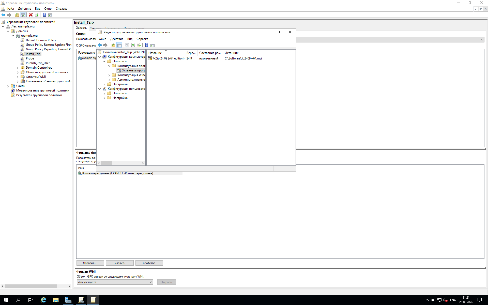

### 15. Установленный 7-Zip

После применения GPO в меню «Пуск» появился **7-Zip File Manager** в разделе «Рекомендуем».

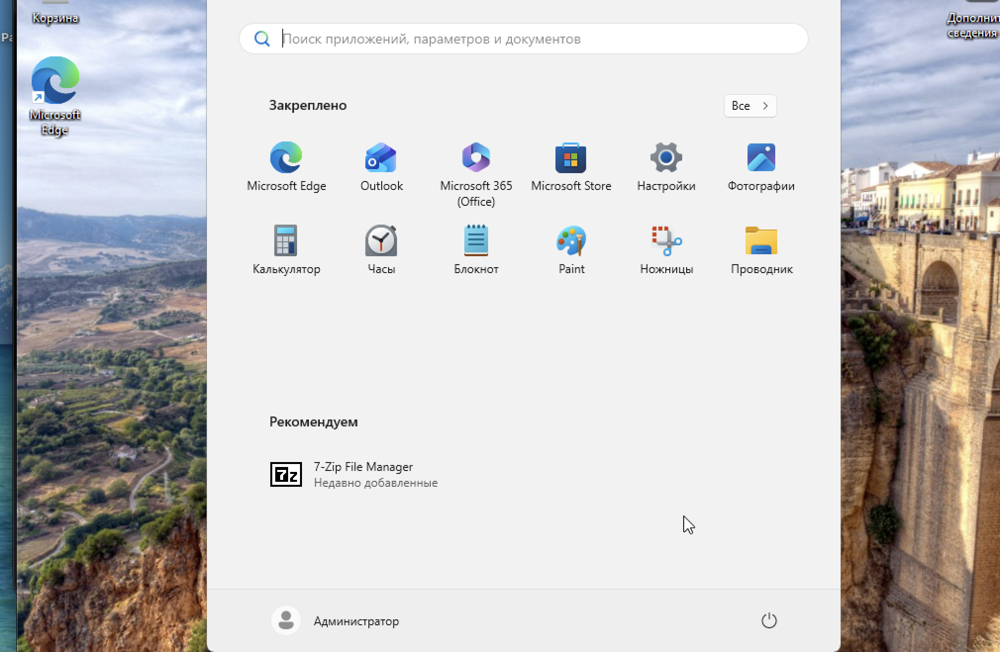

---

## 📸 Задание 4. Публикация MSI через GPO

### 16. GPO Publish_7zip_User — фильтры безопасности

GPO **Publish_7zip_User** применяется для группы **Пользователи домена (EXAMPLE\Пользователи домена)**.

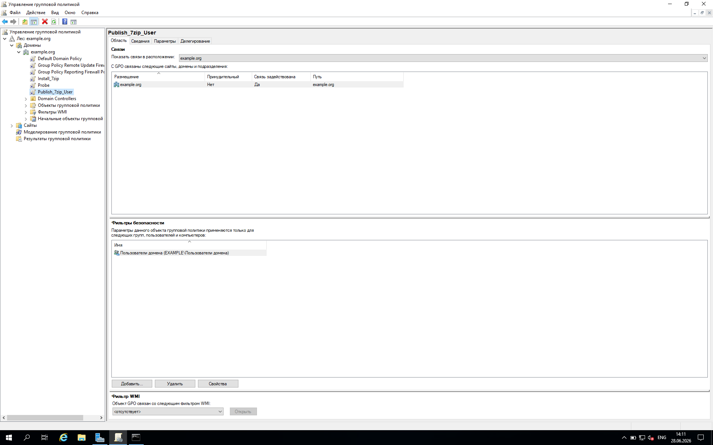

### 17. GPO Publish_7zip_User — редактор

В редакторе: **Конфигурация пользователя → Политики → Конфигурация программ → Установка программ** добавлен пакет **7-Zip 24.09 (x64 edition)** с методом развёртывания **«Публичный»**, источник — `C:\Software\7z2409-x64.msi`.

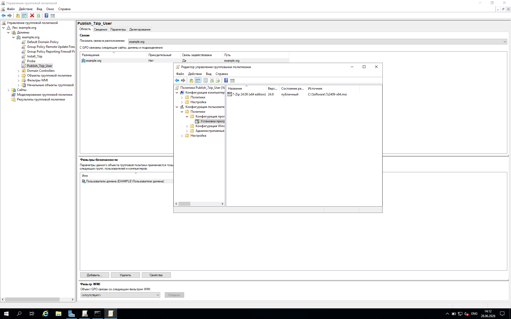

### 18. Список установленных программ

В «Программы и компоненты» отображаются: Microsoft Edge, Microsoft OneDrive, Microsoft Visual C++ 2022, QEMU guest agent, UTM Guest Tools, Подключение к удаленному рабочему столу.

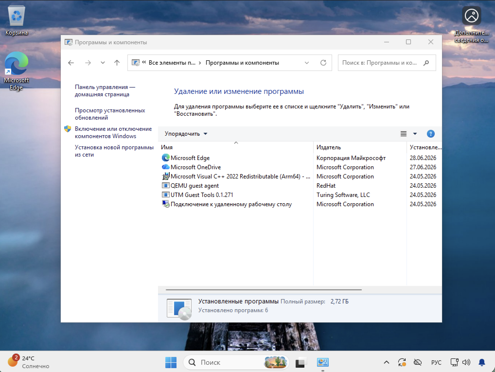

---

## 📸 Задание 5. WSUS — служба обновлений

### 19. Мастер настройки WSUS

При попытке настройки WSUS через мастер настроек возникла проблема: не удалось установить подключение к вышестоящему серверу (Microsoft Update). Потрачено около 2 часов, подключение так и не состоялось. Причины не установлены.

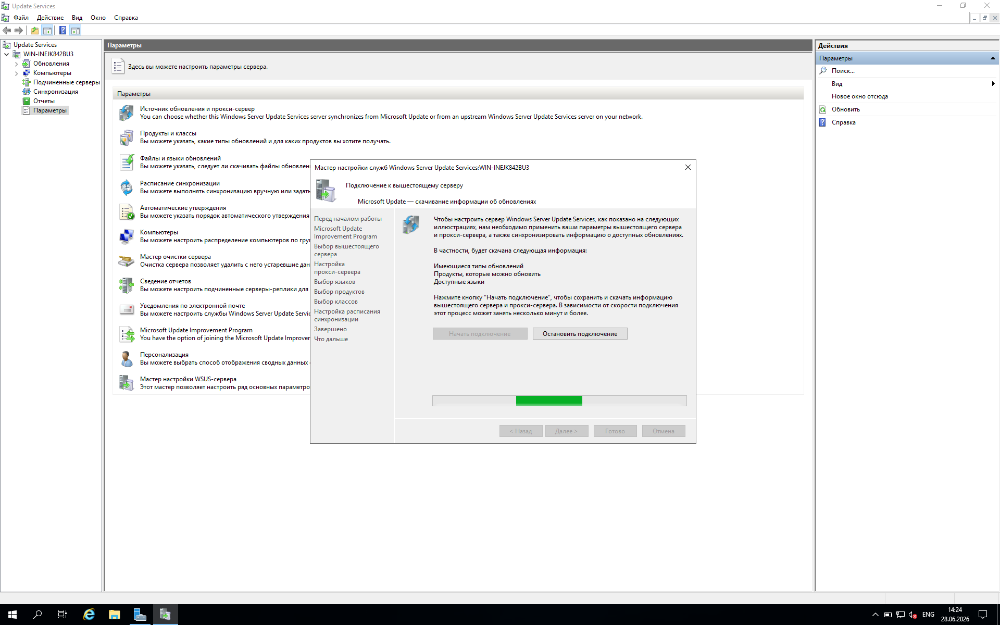

### 20. Параметры сервера WSUS

Общий вид оснастки **Update Services** с деревом: WIN-INEJK842BU3, Обновления, Компьютеры, Подчиненные серверы, Синхронизация, Отчеты, Параметры.

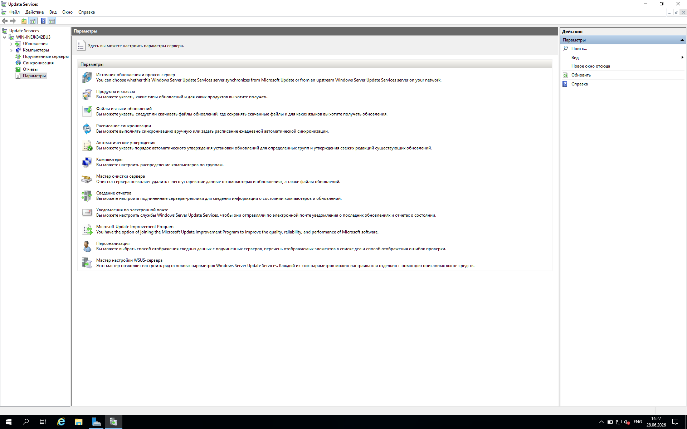

### 21. GPO WSUS_Client — фильтры (Компьютеры домена)

GPO **WSUS_Client** применяется для группы **Компьютеры домена**.

### 22. GPO WSUS_Client — фильтры (Прошедшие проверку)

Тот же GPO, но с фильтром безопасности **«Прошедшие проверку»** (Authenticated Users).

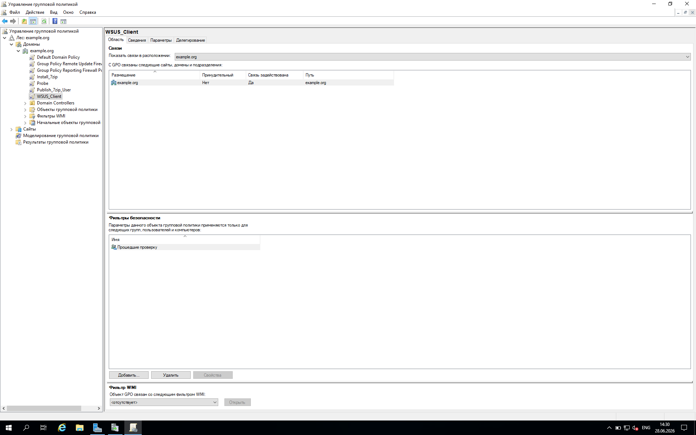

### 23. GPO Центр обновления — Указать размещение

В редакторе GPO: **Конфигурация компьютера → Административные шаблоны → Компоненты Windows → Центр обновления Windows → Указать размещение службы обновлений Microsoft в интрасети** — **Включена**. Указан сервер WSUS.

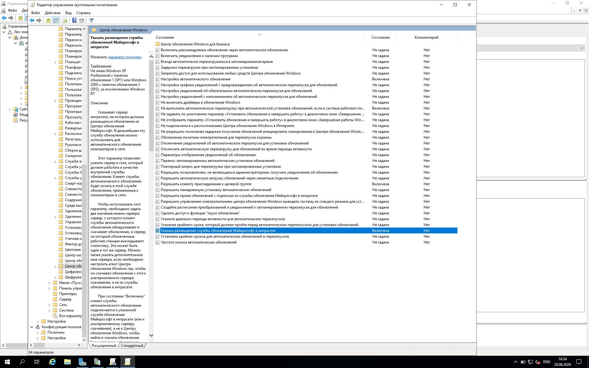

### 24. Установка обновлений

На клиенте запущена установка обновлений: **Выполнено 7%. Не выключайте компьютер.**

### 25. Центр обновления — всё установлено

Центр обновления Windows: **«У вас установлены все последние обновления»**. Время последней проверки — сегодня, 11:15. Доступно предварительное обновление **KB5095093 (26200.8737)**.

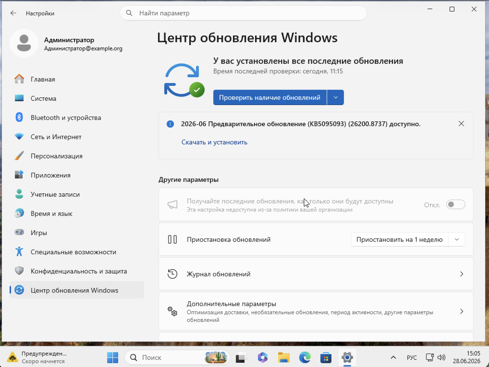

---

## 📊 Выводы
- Освоена настройка Active Directory: создание пользователей с разными привилегиями.
- Отработано подключение клиента к домену example.org.
- Изучена работа с GPO: настройка среды пользователя (скрытие уведомлений, удаление закреплённых программ, отключение Store).
- Освоена автоматическая установка MSI через GPO (метод «Назначенный»).
- Освоена публикация MSI для самостоятельной установки (метод «Публичный»).
- Изучена настройка WSUS: создание GPO для клиентов, указание сервера обновлений.
- Выявлена проблема подключения WSUS к Microsoft Update (требуется дополнительная диагностика).

## 🧠 Чему научился
- Работа с оснасткой `dsa.msc` (Active Directory).
- Работа с `gpmc.msc` (Group Policy Management).
- Создание и применение фильтров безопасности GPO.
- Настройка политик меню «Пуск» и панели задач.
- Развёртывание ПО через GPO: назначенное и публичное.
- Настройка WSUS-клиента через GPO.
- Диагностика через `gpresult`.

## ⚠️ Особенности выполнения
- **WSUS:** не удалось подключить WSUS к вышестоящему серверу Microsoft Update. Возможные причины: блокировка порта 8530/443, ограничения сети, отсутствие доступа к интернету у сервера.
- **Виртуальная сеть:** адаптер «Сетевой мост» в VirtualBox. Это важно для доступа клиента к серверу.
- **DNS:** сервер выполняет роль DNS, клиент получает настройки от сервера (192.168.1.253).
