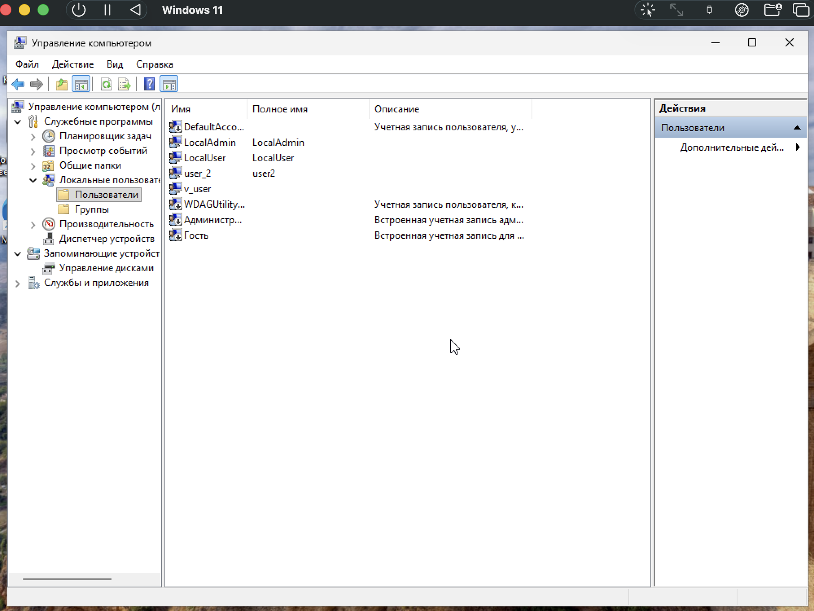
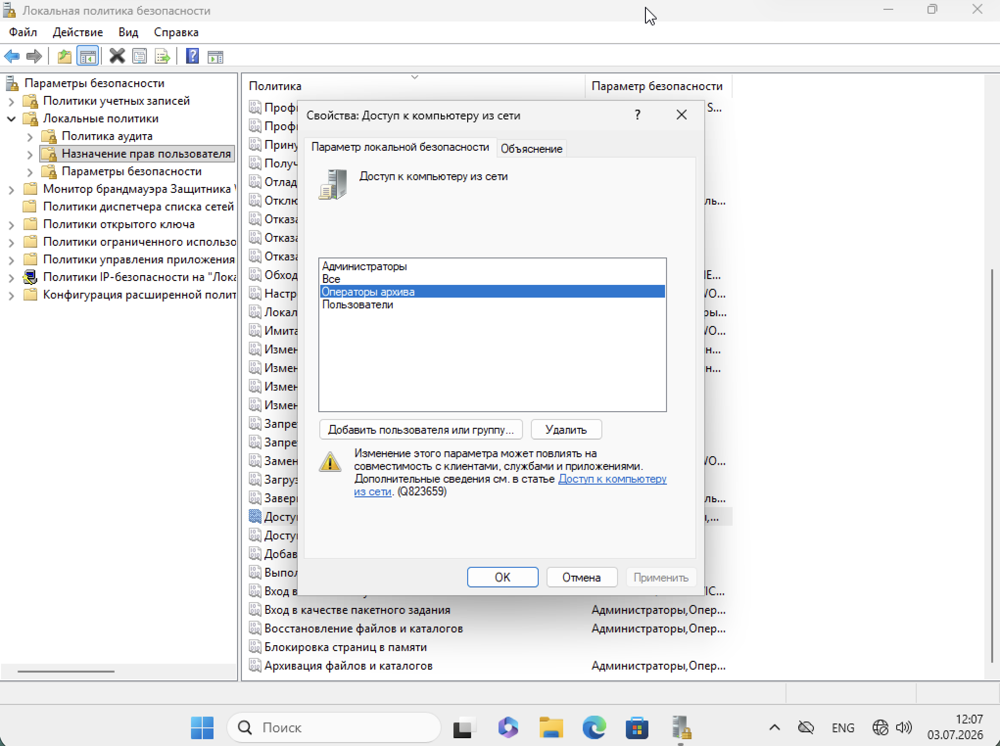
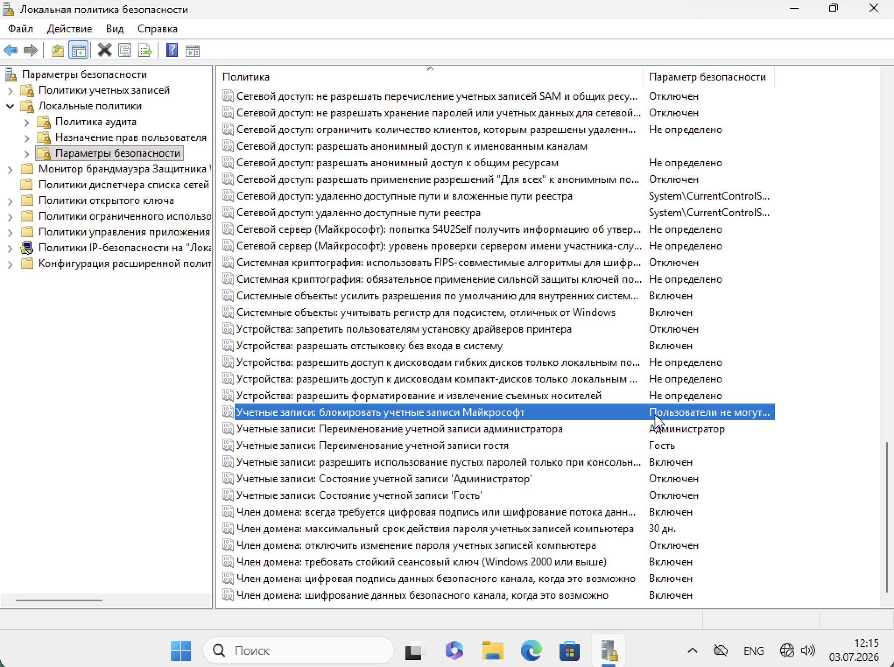
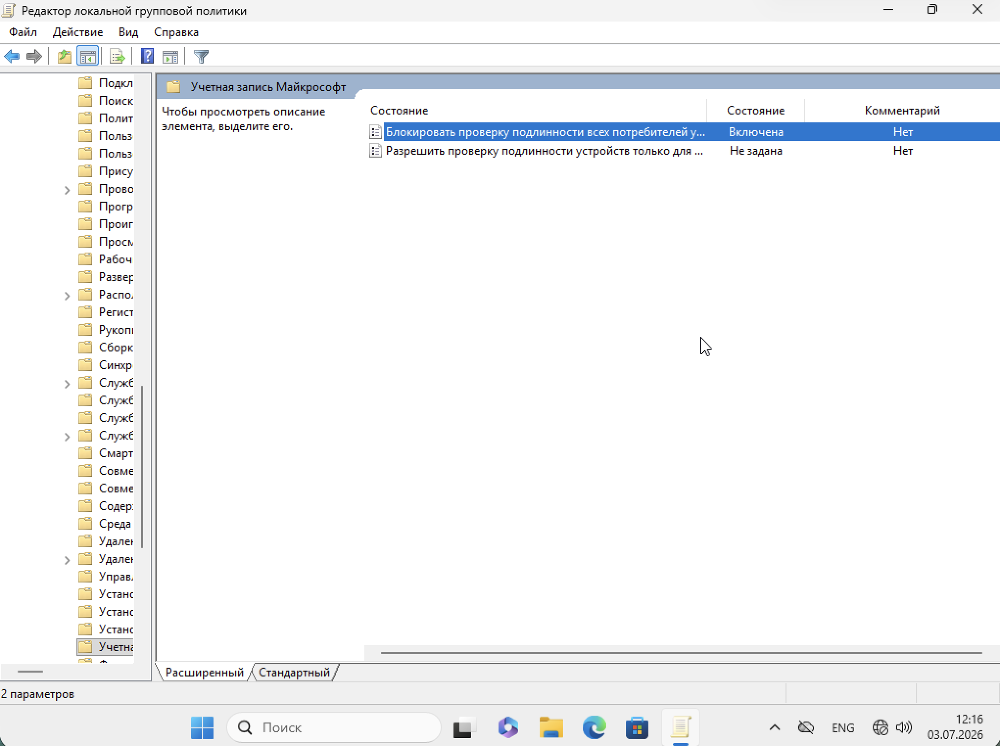
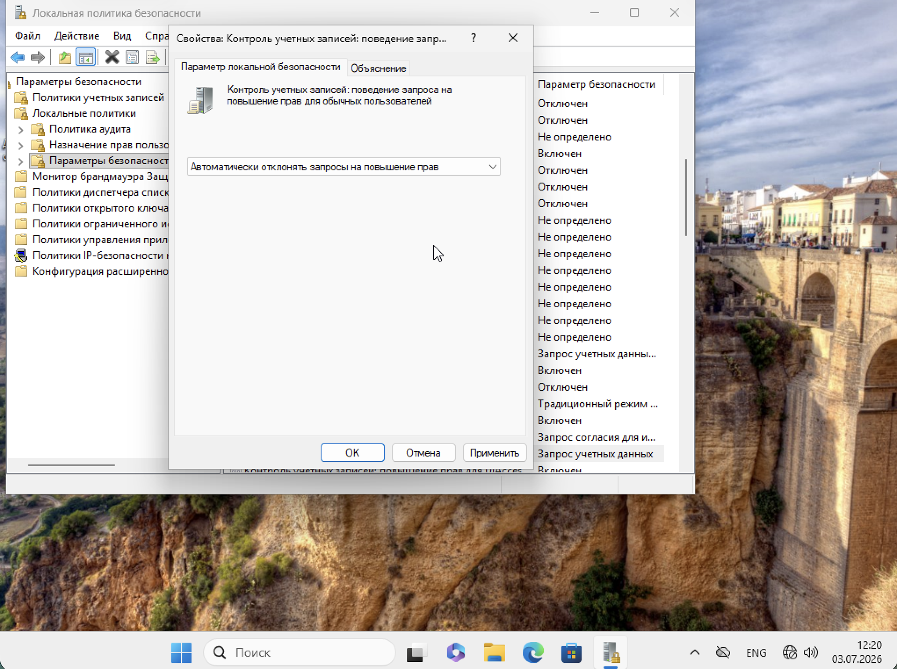
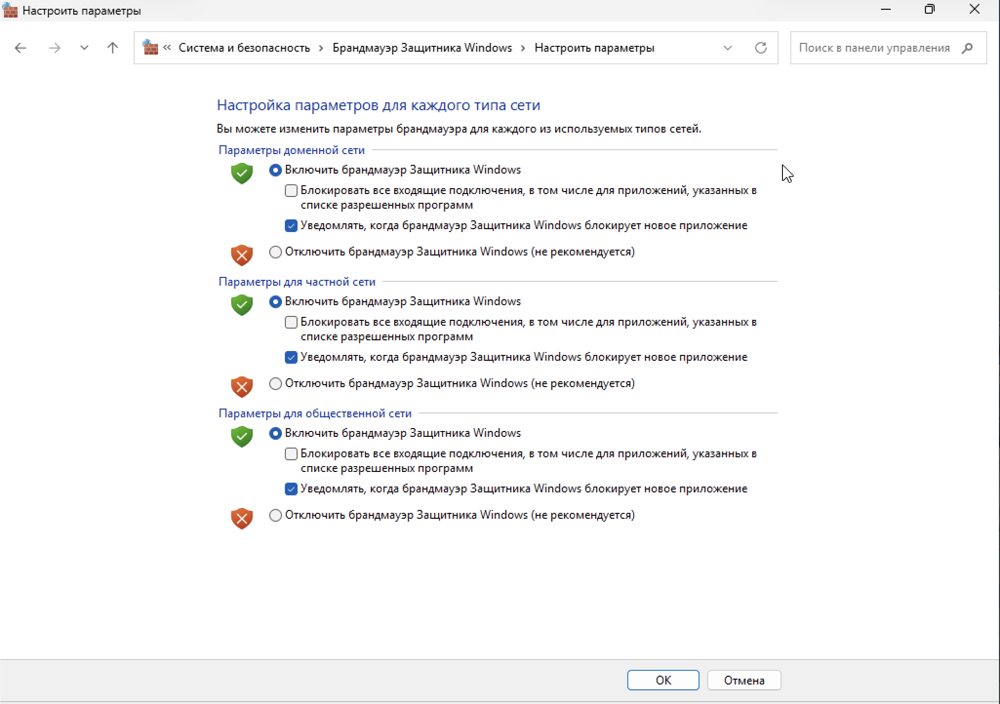

# Практическая работа: Учётные записи, аутентификация и брандмауэр Windows

## 🎯 Цель работы
Закрепить работу с учётными записями, настройку параметров аутентификации через групповую политику и работу с брандмауэром Защитника Windows.

## 📋 Задание
1. Создать учётные записи пользователя и администратора с запретом доступа по сети и удалённого доступа.
2. Настроить запрет аутентификации через учётные записи Майкрософт.
3. Настроить контроль учётных записей (UAC): автоматически отклонять запросы на повышение прав.
4. Настроить брандмауэр Защитника Windows: запрашивать разрешение при установлении нового соединения.

## 🛠️ Использованные инструменты
- Управление компьютером (compmgmt.msc) → Локальные пользователи и группы
- Локальная политика безопасности (secpol.msc)
- Редактор локальной групповой политики (gpedit.msc)
- Брандмауэр Защитника Windows (wf.msc)

---

## 📸 Задание 1. Создание учётных записей

### 1. Список локальных пользователей

В оснастке «Управление компьютером» → «Локальные пользователи и группы» → «Пользователи» созданы учётные записи:

- **LocalAdmin** — администратор (LocalAdmin)
- **LocalUser** — обычный пользователь (LocalUser)
- **user_2** — пользователь (user2)
- **v_user** — служебная учётная запись (WDAGUtilityAccount)
- **Администратор** — встроенная учётная запись администратора
- **Гость** — встроенная учётная запись гостя

### 2. Настройка доступа к компьютеру из сети

В оснастке `secpol.msc` → «Локальные политики» → «Назначение прав пользователя» → **«Доступ к компьютеру из сети»** настроены разрешения:

- **Администраторы**
- **Все**
- **Операторы архива**
- **Пользователи**

Это право определяет, каким учётным записям разрешено подключаться к системе по сети. Для ограничения доступа можно удалить из списка ненужные группы (например, «Все»), оставив только «Администраторы».

Аналогично настраиваются права **«Запретить доступ к компьютеру из сети»** и **«Запретить удалённый доступ»** — для явной блокировки конкретных учётных записей.

---

## 📸 Задание 2. Запрет аутентификации через учётные записи Майкрософт

### 3. Параметры безопасности — блокировка учётных записей Майкрософт

В оснастке `secpol.msc` → «Локальные политики» → «Параметры безопасности» найдена политика:

**«Учетные записи: блокировать учетные записи Майкрософт»** — параметр: **Пользователи не могут добавлять учетные записи Майкрософт или входить с ними**.

Это значит: пользователи не смогут использовать личные аккаунты Microsoft для входа в систему и добавления учётных записей.

Также в разделе настроены сопутствующие политики:
- «Учетные записи: состояние учетной записи "Администратор"» — Отключен
- «Учетные записи: состояние учетной записи "Гость"» — Отключен
- «Сетевая безопасность: не разрешать хранение паролей» — Отключен

### 4. Групповая политика — блокировка проверки подлинности Microsoft

В оснастке `gpedit.msc` → «Конфигурация компьютера» → «Административные шаблоны» → «Система» → «Учетные записи Майкрософт»:

Политика **«Блокировать проверку подлинности всех потребителей учетных записей Майкрософт»** — состояние: **Включена**.

Политика запрещает пользователям и приложениям использовать учётные записи Майкрософт для входа в систему, приложения и службы. При включении этого параметра пользователи не смогут добавлять личные учётные записи Microsoft.

---

## 📸 Задание 3. Контроль учётных записей (UAC)

### 5. Настройка UAC — автоматически отклонять запросы

В оснастке `secpol.msc` → «Локальные политики» → «Параметры безопасности» → **«Контроль учетных записей: поведение запроса на повышение прав для обычных пользователей»** установлено значение:

**«Автоматически отклонять запросы на повышение прав»**

Это значит: когда обычный пользователь попытается выполнить действие, требующее административных прав, запрос UAC будет отклонён автоматически — без всплывающего окна. Пользователь не сможет повысить свои привилегии.

Такая настройка применяется на компьютерах операторов, работающих с фиксированным набором задач, чтобы исключить случайное или намеренное повышение прав.

---

## 📸 Задание 4. Брандмауэр Защитника Windows

### 6. Настройка параметров брандмауэра

В «Брандмауэр Защитника Windows» → «Настроить параметры» для всех трёх типов сетей (доменная, частная, общественная) установлено:

- **Включить брандмауэр Защитника Windows** — выбрано.
- **Уведомлять, когда брандмауэр Защитника Windows блокирует новое приложение** — галочка установлена.

Это значит: при попытке приложения или службы установить новое входящее соединение, которое блокируется брандмауэром, пользователь получит уведомление с предложением разрешить или заблокировать соединение.

Настройка применима ко всем трём профилям сети — доменному, частному и общественному.

---

## 📊 Выводы
- Освоено создание локальных учётных записей с разными привилегиями.
- Изучена настройка прав доступа к компьютеру из сети через оснастку «Локальная политика безопасности».
- Настроен запрет использования учётных записей Майкрософт на двух уровнях: параметры безопасности и групповая политика.
- Настроен контроль учётных записей (UAC) с автоматическим отклонением запросов на повышение прав.
- Настроен брандмауэр Защитника Windows с уведомлением о блокировке новых приложений.
- Понята логика защиты системы: ограничение доступа + блокировка внешних учётных записей + контроль повышения прав + фильтрация сетевых соединений.

## 🧠 Чему научился
- Работа с `compmgmt.msc` для управления пользователями.
- Работа с `secpol.msc` для настройки прав и параметров безопасности.
- Работа с `gpedit.msc` для блокировки учётных записей Майкрософт.
- Настройка UAC для автоматического отклонения запросов.
- Настройка брандмауэра Windows для уведомлений о новых соединениях.
- Понимание разницы между правами пользователя и администратора.
- Понимание, как групповая политика блокирует внешние учётные записи.

## 🔐 Практическая значимость
Эти настройки — базовый уровень защиты рабочей станции:
- запрет сетевого и удалённого доступа ограничивает поверхность атаки;
- блокировка учётных записей Microsoft исключает использование личных аккаунтов в корпоративной среде;
- автоматическое отклонение UAC предотвращает повышение прав обычными пользователями;
- брандмауэр с уведомлениями позволяет контролировать входящие соединения.

Всё это соответствует требованиям регуляторов (152-ФЗ, приказы ФСТЭК) к защите рабочих мест операторов.
