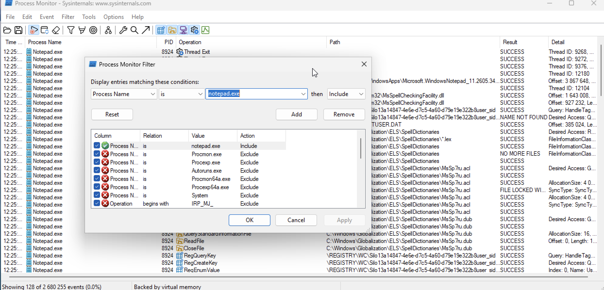
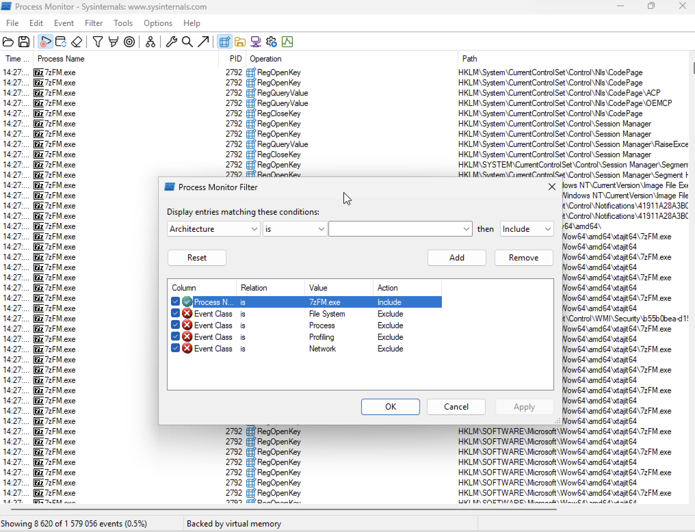
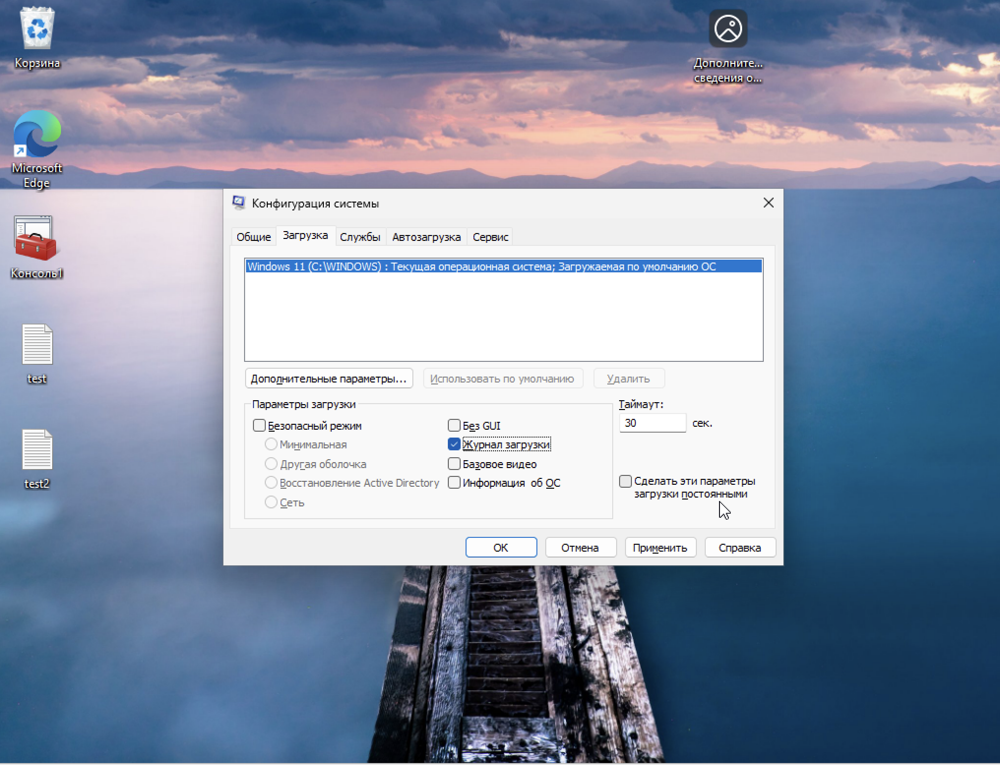

# Практическая работа: Реестр Windows и консоль восстановления

## 🎯 Цель работы
Научиться выполнять операции с реестром Windows: навигацию, резервное копирование и восстановление, а также загружать Windows в режиме консоли восстановления.

## 📋 Задание
1. Запустить Блокнот и ProcMon, настроить фильтр по обращениям к реестру.
2. Настроить аналогичный фильтр для 7-Zip.
3. Включить лог загрузки ОС, отфильтровать по реестру.
4. Найти файл ntbtlog.txt и показать его.
5. Запустить режим восстановления Windows (Windows 10/11).
6. Создать резервные копии реестра: HKLM, HKU.
7. Создать точку восстановления системы.
8. (Доп.) Восстановить реестр из файлов через reg.exe.

## 🛠️ Использованные инструменты
- Process Monitor (ProcMon) от Sysinternals
- Конфигурация системы (msconfig)
- Проводник
- Среда восстановления Windows (WinRE)
- Редактор реестра (regedit)
- Утилита reg.exe

---

## 📸 Задание 1. Мониторинг обращений к реестру через ProcMon

### 1. Фильтр для notepad.exe

В Process Monitor настроен фильтр:
- **Process Name** is `notepad.exe` → Include
- Исключены: `Procmon.exe`, `Procexp.exe`, `Autoruns.exe`, `System`, а также операции с `IRP_MJ_`

В выводе видно **128 событий** (0.0% от 2 680 255), в том числе:
- `RegQueryKey` — чтение разделов реестра
- `RegCreateKey` — создание ключей
- `RegEnumValue` — перечисление значений
- Пути: `\REGISTRY\WC\Silo13a14847...`, `HKCU\Software\Microsoft\Windows\CurrentVersion\...`

Это показывает, какие ключи реестра читает и создаёт Блокнот при запуске и работе.

### 2. Фильтр для 7-Zip (7zFM.exe)

В Process Monitor настроен фильтр:
- **Process Name** is `7zFM.exe` → Include
- Исключены: File System, Process, Profiling, Network

В выводе — **8 620 событий** (0.5% от 1 579 056):
- `RegOpenKey`, `RegQueryValue`, `RegCloseKey`
- Пути: `HKLM\System\CurrentControlSet\Control\Nls\CodePage`, `HKLM\System\CurrentControlSet\Control\Session Manager`, `HKLM\SOFTWARE\Microsoft\Wow64\amd64\xtajit64\7zFM.exe`

Видно, что 7-Zip активно читает ключи локализации, Session Manager и ветки WOW64.

---

## 📸 Задание 2. Лог загрузки ОС

### 3. Включение журнала загрузки

В оснастке «Конфигурация системы» (`msconfig`) → вкладка **«Загрузка»**:
- Выбрана **Windows 11 (C:\WINDOWS): Текущая операционная система**
- Установлена галочка **«Журнал загрузки»**
- Таймаут: 30 сек.
- Параметры загрузки: Без GUI, Безопасный режим и др. — не выбраны

Файл журнала загрузки: `C:\Windows\ntbtlog.txt`. Галочка «Сделать эти параметры загрузки постоянными» — снята.

### 4. Файл ntbtlog.txt

В проводнике найден файл **ntbtlog.txt**:
- Размер: **18,3 КБ**
- Дата изменения: **28.07.2026 14:30**

Содержимое файла — список загруженных драйверов и компонентов:
