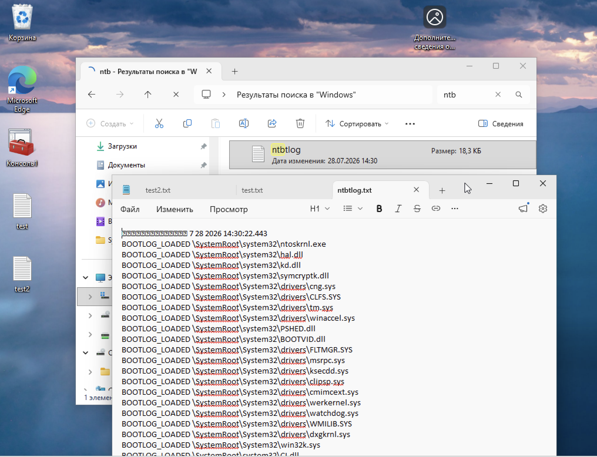
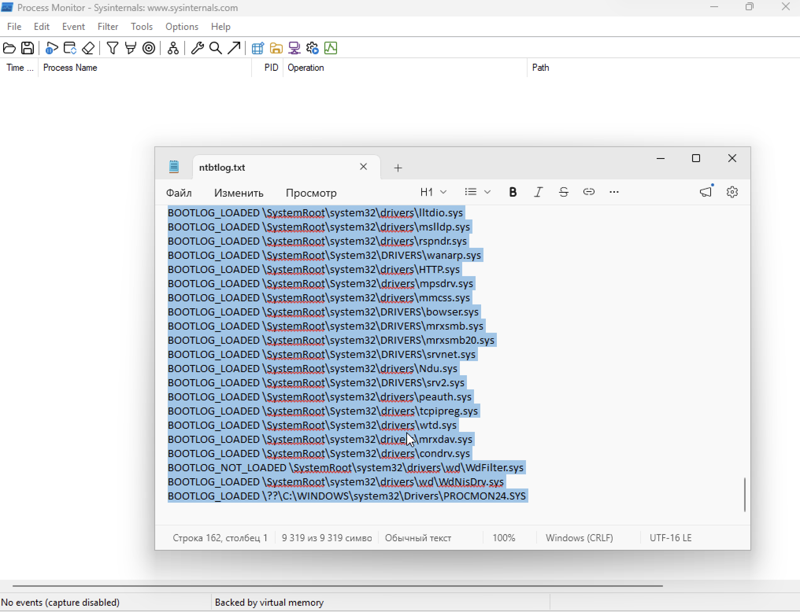
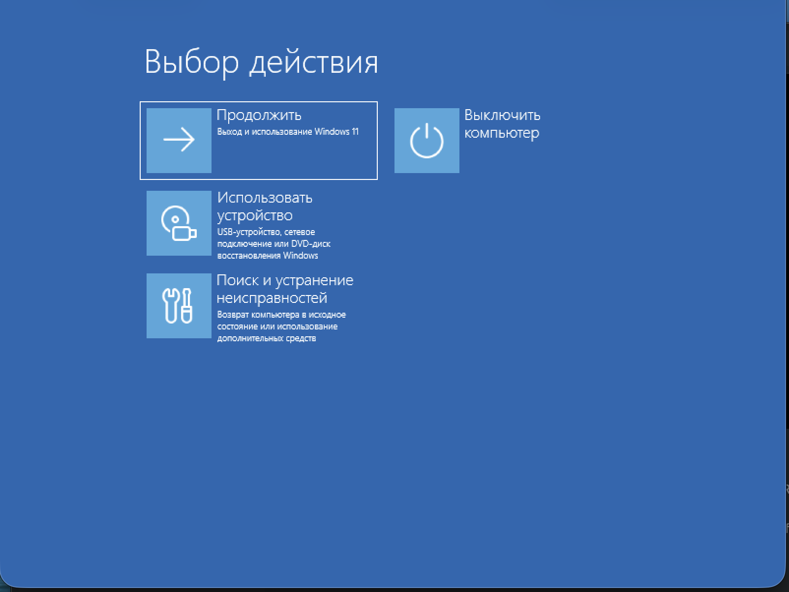
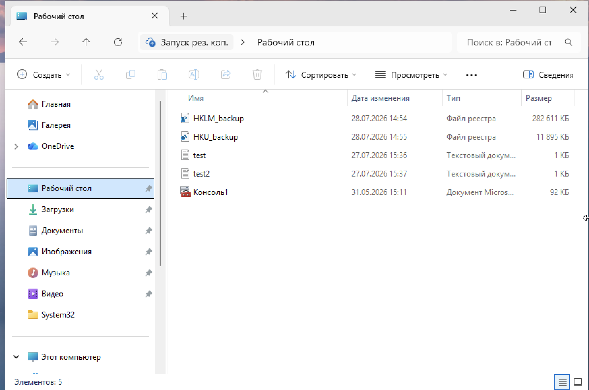
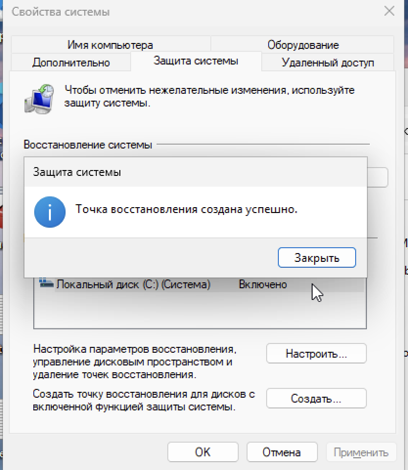

Каждая строка — либо `BOOTLOG_LOADED` (драйвер загружен), либо `BOOTLOG_NOT_LOADED` (не загружен). Всего 162 строки, 9 319 символов.

### 5. Фильтр в ProcMon по реестру лога загрузки

В Process Monitor открыт файл `ntbtlog.txt`, фильтр настроен на обращения к реестру. Видно, что драйвер **PROCMON24.SYS** загружается вместе с системой. В строке состояния — «No events (capture disabled)» — захват остановлен, но данные уже зафиксированы.

Это показывает, что ProcMon сам становится драйвером, который виден в журнале загрузки.

---

## 📸 Задание 3. Режим восстановления Windows

### 6. Среда восстановления Windows

Запущена среда восстановления Windows (WinRE). На экране «Выбор действия» доступны:
- **Продолжить** — выход и использование Windows 11
- **Использовать устройство** — USB, сетевое подключение или DVD-диск восстановления
- **Поиск и устранение неисправностей** — возврат компьютера в исходное состояние или использование дополнительных средств
- **Выключить компьютер**

В разделе «Поиск и устранение неисправностей» доступны: восстановление при загрузке, удаление обновления, восстановление системы, командная строка, параметры встроенного ПО UEFI, параметры запуска.

---

## 📸 Задание 4. Резервные копии реестра

### 7. Файлы резервных копий

В проводнике (папка «Запуск рез. коп.» → Рабочий стол) созданы файлы:

| Файл | Дата | Тип | Размер |
|------|------|-----|--------|
| **HKLM_backup** | 28.07.2026 14:54 | Файл реестра | **282 611 КБ** |
| **HKU_backup** | 28.07.2026 14:55 | Файл реестра | **11 895 КБ** |

Также в папке: `test`, `test2` (текстовые документы, 1 КБ), `Консоль1` (документ Microsoft, 92 КБ).

Экспорт выполнен через `regedit` → правый клик по ветке → «Экспортировать». Файлы содержат полные копии кустов:
- **HKLM_backup** — куст `HKEY_LOCAL_MACHINE`
- **HKU_backup** — куст `HKEY_USERS`

Размер файлов подтверждает, что это полноценные копии (HKLM весит ~280 МБ, HKU ~12 МБ).

---

## 📸 Задание 5. Точка восстановления системы

### 8. Создание точки восстановления

В окне «Свойства системы» → вкладка **«Защита системы»** → нажата кнопка **«Создать…»**. Появилось сообщение:

> **Точка восстановления создана успешно.**

Защита системы для диска (C:) включена. Доступны кнопки:
- **Настроить…** — параметры восстановления и место на диске
- **Создать…** — создать точку восстановления вручную

Точка восстановления позволяет откатить систему к состоянию на момент её создания, если после этого были внесены нежелательные изменения.

---

## 📊 Выводы
- Освоена работа с Process Monitor: фильтрация событий по процессу и типу обращения.
- Изучены обращения к реестру со стороны стандартных приложений (Блокнот, 7-Zip).
- Отработано включение журнала загрузки через `msconfig` и анализ файла `ntbtlog.txt`.
- Изучен формат журнала загрузки: `BOOTLOG_LOADED` и `BOOTLOG_NOT_LOADED` для драйверов.
- Отработана загрузка в среду восстановления Windows (WinRE).
- Освоено резервное копирование кустов реестра HKLM и HKU.
- Отработано создание точки восстановления системы.
- Понята логика восстановления Windows: WinRE + резервные копии реестра + точки восстановления.

## 🧠 Чему научился
- Работа с `ProcMon` и фильтрами по Process Name.
- Работа с `msconfig` для включения журнала загрузки.
- Анализ `ntbtlog.txt`: загруженные и незагруженные драйверы.
- Работа со средой восстановления WinRE.
- Экспорт кустов реестра через `regedit`.
- Создание точек восстановления через «Свойства системы».
- Понимание, чем отличаются резервная копия куста и точка восстановления.
- Понимание, что ProcMon сам является драйвером и виден в журнале загрузки.

## 🔐 Практическая значимость
Работа с реестром и восстановлением — базовый навык администратора и ИБ-специалиста:
- мониторинг обращений к реестру помогает выявлять подозрительную активность (малварь, автозапуск);
- журнал загрузки позволяет диагностировать проблемы с драйверами;
- резервные копии реестра и точки восстановления — способ быстро откатить систему;
- WinRE используется для восстановления системы при критических сбоях и расследования инцидентов.
