# Практическая работа: Основные командлеты PowerShell

## 🎯 Цель работы
Познакомиться с основными командлетами PowerShell, научиться искать и запускать их.

## 📋 Задание
1. Запустить PowerShell, проверить версию.
2. Найти связанные команды: Get-Process → Get-Member → Get-Command.
3. Вывести службы постранично через Get-CimInstance.
4. Завершить работу компьютера через Stop-Computer.
5. Получить сведения о процессах explorer и powershell.
6. Определить зависимости службы Spooler.
7. Перечислить диски, создать каталог C:\temp и подключить его как диск Temp.
8. (Доп.) Проверить связь с тремя компьютерами через массив.

## 🛠️ Использованные командлеты
- $PSVersionTable.PSVersion — версия PowerShell
- Get-Process — список процессов
- Get-Member — члены объекта
- Get-Command — поиск командлетов
- Get-CimInstance — WMI-объекты
- Stop-Computer — завершение работы
- Get-Service — список служб
- Get-PSDrive — список дисков PowerShell
- New-Item — создание каталога
- New-PSDrive — создание диска
- Test-Connection — проверка связи
- ipconfig — сетевые параметры

---

## 📸 Задание 1. Версия PowerShell

### 1. Проверка версии

$PSVersionTable.PSVersion

Результат:
- Major: 5
- Minor: 1
- Build: 26100
- Revision: 8655

Это Windows PowerShell 5.1, встроенная в Windows 11.

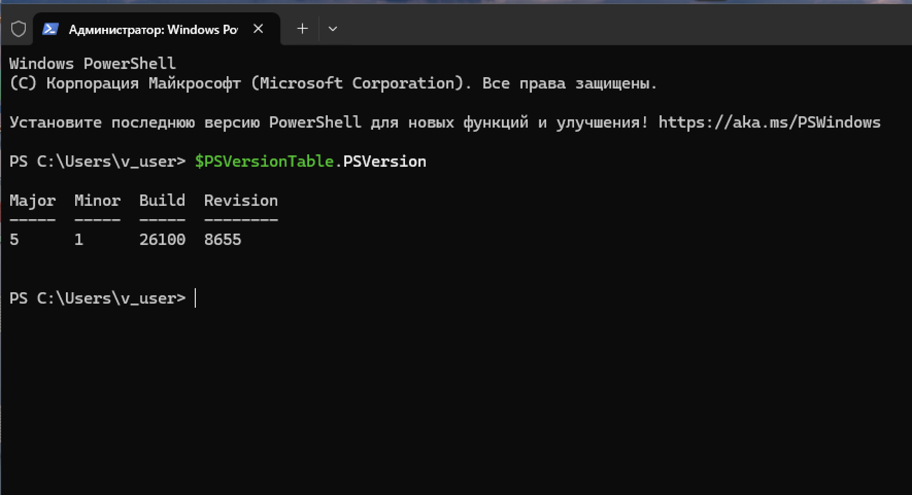

---

## 📸 Задание 2. Связанные команды

### 2. Тип объекта Get-Process

Get-Process | Get-Member | Select-Object TypeName -Unique

Результат: **System.Diagnostics.Process**

Это значит: командлет Get-Process возвращает объекты типа System.Diagnostics.Process. Зная тип объекта, можно найти другие командлеты, работающие с этим же типом.

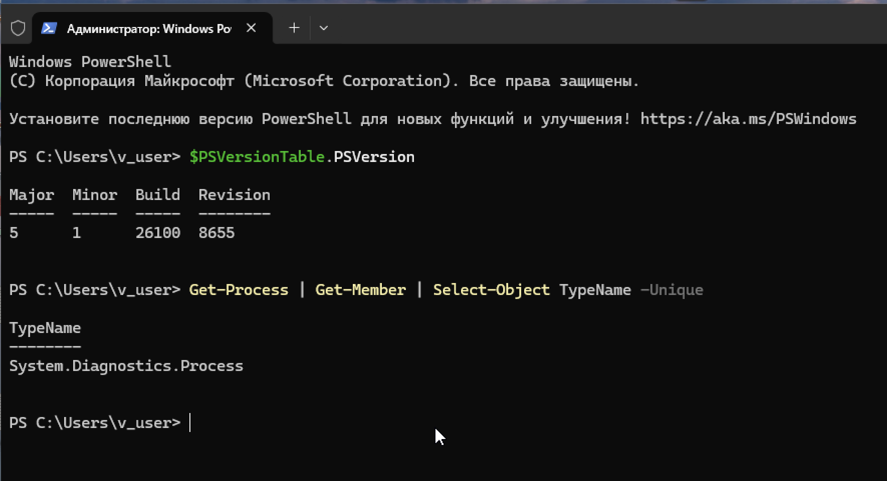

### 3. Поиск командлетов по типу

Get-Command -ParameterType Process

Найдены командлеты, работающие с типом Process:
- Debug-Process
- Enter-PSHostProcess
- Get-Process
- Get-PSHostProcessInfo
- Stop-Process
- Wait-Process

Все они находятся в модуле Microsoft.PowerShell.Management (версия 3.1.0.0), кроме Enter-PSHostProcess и Get-PSHostProcessInfo — они в Microsoft.PowerShell.Core.

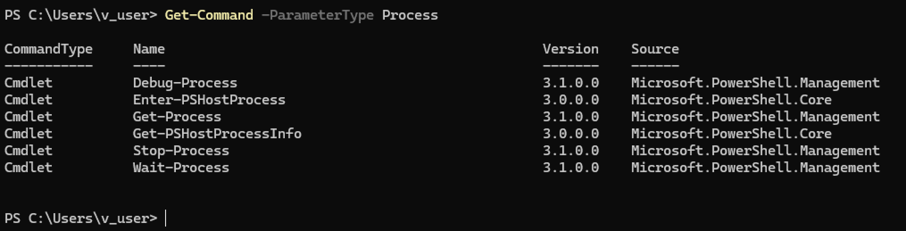

---

## 📸 Задание 3. Состояние служб постранично

### 4. Список служб через CIM

Get-CimInstance -ClassName Win32_Service | Select-Object -Property Status,Name,DisplayName | more

Выводятся все службы Windows с их статусом (OK), именем и отображаемым именем:
- ADPSvc — Служба платформы агрегированных данных
- ALG — Служба шлюза уровня приложения
- AppIDSvc — Удостоверение приложения
- Appinfo — Сведения о приложении
- AudioSrv — Windows Audio
- BDESVC — Служба шифрования дисков BitLocker
- BITS — Фоновая интеллектуальная служба передачи

Параметр `more` позволяет листать вывод постранично.

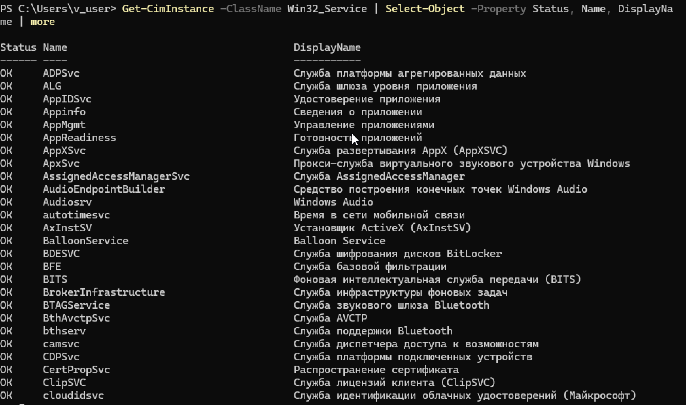

### 5. Завершение работы компьютера

Stop-Computer -Force

Команда принудительно завершает работу компьютера без предварительного предупреждения приложений.

---

## 📸 Задание 4. Процессы explorer и powershell

### 6. Получение сведений о процессах

Get-Process -Name explorer, powershell

Результат:

| ProcessName | Id | CPU(s) | WS(K) | Handles |
|-------------|-----|--------|-------|---------|
| explorer | 5896 | 10,13 | 213732 | 3114 |
| powershell | 8932 | 2,61 | 95796 | 749 |

- **explorer** — процесс проводника Windows, использует больше памяти и CPU
- **powershell** — сама консоль PowerShell

Столбцы: Handles, NPM(K), PM(K), WS(K) — рабочее множество (память), CPU(s), Id, SI (сессия), ProcessName.

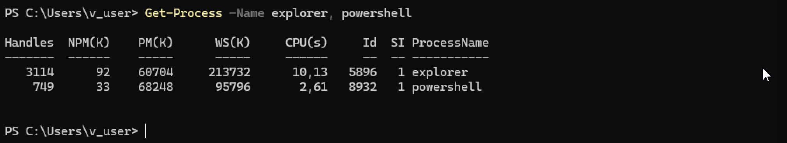

---

## 📸 Задание 5. Зависимости службы Spooler

### 7. Службы, от которых зависит Spooler, и зависимые службы

Get-Service -Name Spooler | Select-Object -Property Name, DependentServices, ServicesDependedOn

Результат:
- **Name:** Spooler
- **DependentServices:** {} — нет служб, зависящих от Spooler
- **ServicesDependedOn:** {RPCSS, http} — Spooler зависит от службы RPCSS и драйвера http

Это значит: Spooler (диспетчер печати) не может работать без RPCSS и http.

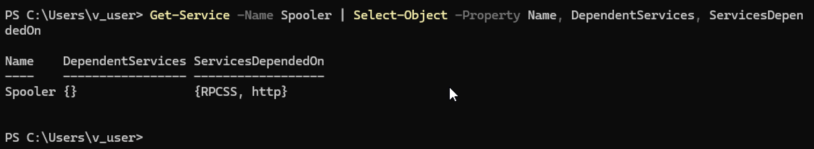

---

## 📸 Задание 6. Диски PowerShell

### 8. Список дисков до создания Temp

Get-PSDrive -PSProvider FileSystem

Результат:

| Name | Used (GB) | Free (GB) | Root |
|------|-----------|-----------|------|
| C | 30,51 | 32,51 | C:\ |
| D | 0,12 | 0,00 | D:\ |
| E | — | — | E:\ |
| Z | 30,51 | 32,51 | \\localhost@9843\DavWWRoot |

Диск Z — это WebDAV-ресурс (подключённая папка или сетевой диск).

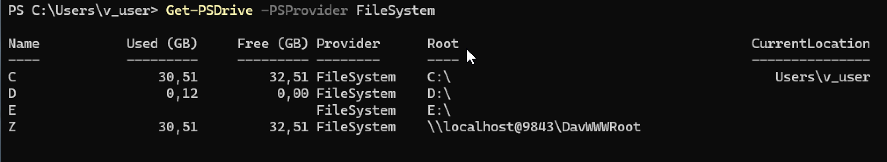

### 9. Создание каталога C:\temp

New-Item -Path C:\temp -ItemType Directory -Force

Результат:
- Mode: d-----
- LastWriteTime: 18.08.2026 16:11
- Name: temp

Каталог `C:\temp` создан. Параметр `-Force` подавляет ошибку, если каталог уже существует.

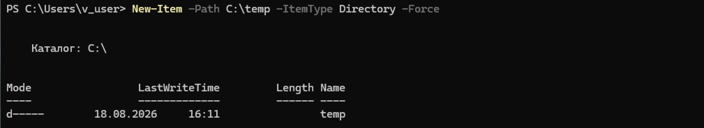

### 10. Создание диска Temp

New-PSDrive -Name Temp -PSProvider FileSystem -Root C:\temp

Результат:
- Name: Temp
- Used (GB): 0,00
- Free (GB): 32,51
- Root: C:\temp

Диск Temp создан и указывает на папку `C:\temp`.

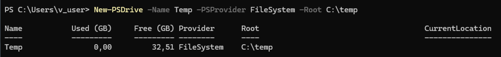

### 11. Список дисков после создания Temp

Get-PSDrive -PSProvider FileSystem

В списке появился новый диск **Temp** с корнем `C:\temp`. Теперь список: C, D, E, Temp, Z.

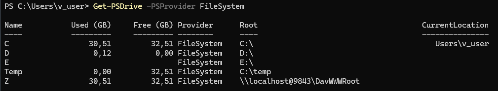

---

## 📸 Дополнительное задание. Проверка связи с тремя компьютерами

### 12. Сетевые параметры

ipconfig

Результат для адаптера Ethernet:
- IPv4-адрес: **192.168.64.18**
- Маска подсети: 255.255.255.0
- Основной шлюз: 192.168.64.1

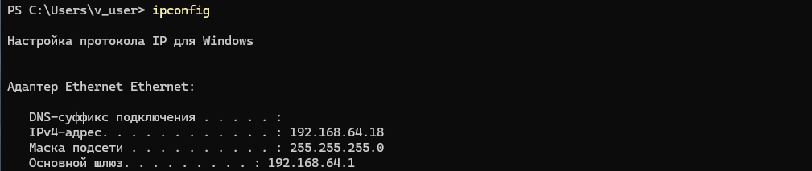

### 13. Проверка связи с массивом компьютеров

$computers = @("192.168.64.1", "192.168.64.18", "8.8.8.8")
Test-Connection -ComputerName $computers -Count 2

Результат:
- **192.168.64.1** — ошибка: «Этот хост неизвестен» (PingException)
- **192.168.64.18** — успешно, 32 байта, время 0 мс (это локальный хост)
- **8.8.8.8** — успешно, 32 байта, время 144 мс и 27 мс (интернет работает)

Команда демонстрирует проверку связи сразу с несколькими узлами через массив.

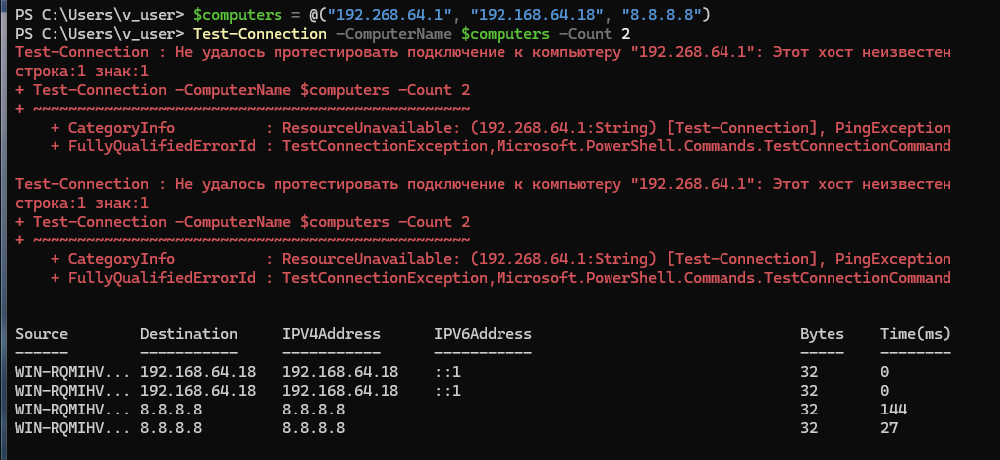

---

## 📊 Выводы
- Освоена работа с версией PowerShell через `$PSVersionTable`.
- Изучен принцип поиска связанных командлетов: `Get-Process → Get-Member → Get-Command`.
- Отработана работа с WMI через `Get-CimInstance`.
- Изучены командлеты управления: `Stop-Computer`, `Get-Service`, `Get-PSDrive`, `New-Item`, `New-PSDrive`.
- Освоена работа с массивами и `Test-Connection` для проверки связи.
- Понята разница между обычными дисками и дисками PowerShell (PSDrive).
- Отработано создание каталога через `New-Item` и подключение его как PSDrive.

## 🧠 Чему научился
- Работа с командлетами PowerShell.
- Использование конвейера `|` для обработки объектов.
- Поиск связанных команд через `Get-Member` и `Get-Command`.
- Работа с массивами в PowerShell (`@(...)`).
- Управление службами, дисками и каталогами.
- Диагностика сети через `ipconfig` и `Test-Connection`.
