# Практическая работа: Доменные службы Active Directory

## 🎯 Цель работы
Закрепить навыки работы с доменными службами Active Directory, диспетчером серверов и оснасткой «Пользователи и компьютеры Active Directory». Настроить клиентские компьютеры и подключить их к домену.

## 📋 Задание
1. Подготовить сервер: установить обновления, языковой пакет, настроить сеть.
2. Установить роли AD DS и DNS.
3. Создать новый лес и домен example.com.
4. Создать пользователя testuser с паролем.
5. Изучить параметры учётной записи: смена пароля, запрет смены, отключение, срок действия.
6. Заблокировать и разблокировать учётную запись.
7. Подготовить и подключить клиентский компьютер к домену.
8. Войти под testuser на клиенте.
9. Удалить компьютер из домена.
10. Удалить роли AD DS с контроллера домена.

## 🛠️ Использованные инструменты
- Диспетчер серверов (ServerManager)
- PowerShell (Install-WindowsFeature, Uninstall-WindowsFeature)
- Active Directory — пользователи и компьютеры (dsa.msc)
- Свойства системы (sysdm.cpl)
- Настройка сетевых подключений (ncpa.cpl)
- Центр обновления Windows
- Параметры языка Windows

## 🌐 Схема сети

| Машина | IP-адрес | Маска | Шлюз | DNS |
|--------|----------|-------|------|-----|
| Сервер (WIN-GJE0G3GES52) | 192.168.3.117 | 255.255.255.0 | 192.168.3.1 | 127.0.0.1 |
| Клиент (WIN-A4C5EPBKH86) | — | — | — | — |

---

## 📸 Задание 1. Подготовка сервера

### 1. Настройка сети сервера

В свойствах IPv4 установлено:
- IP-адрес: **192.168.3.117**
- Маска подсети: 255.255.255.0
- Основной шлюз: 192.168.3.1
- Предпочитаемый DNS-сервер: **127.0.0.1**

DNS указывает на localhost, потому что после установки AD DS сервер сам будет выполнять роль DNS-сервера.

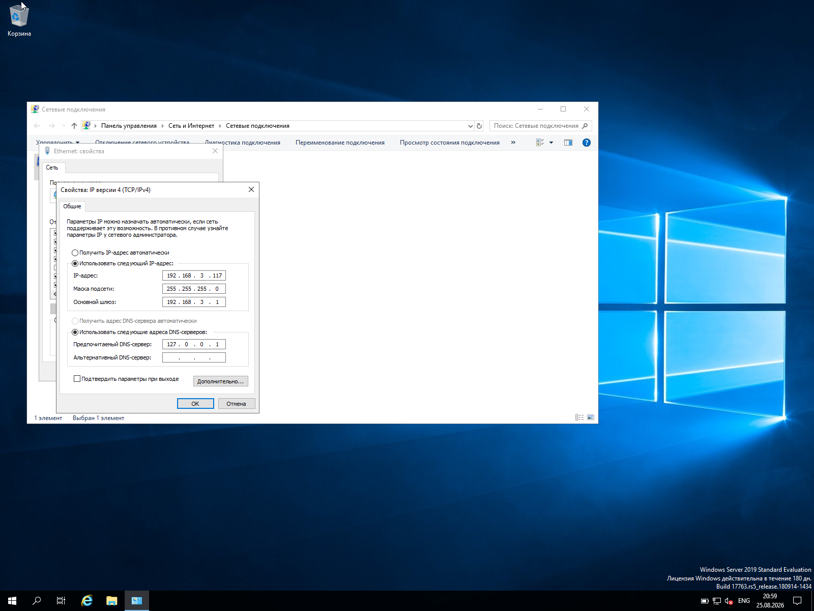

### 2. Установка языкового пакета

В параметрах Windows → «Время и язык» → «Язык»:
- Язык интерфейса Windows: **Русский**
- Предпочитаемые языки: **Русский**, **English (United States)**
- English установлен как язык поиска языкового пакета

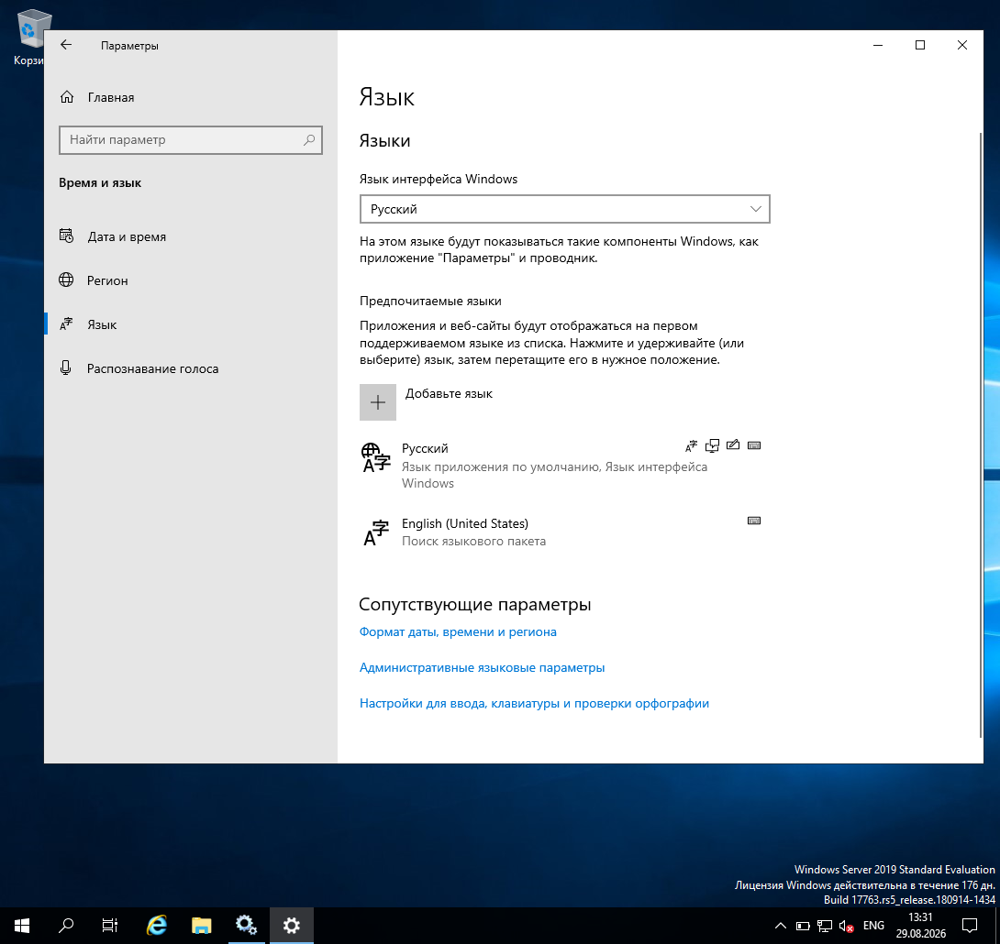

### 3. Проверка центра обновления

В «Центре обновления Windows»:
- Обновлений нет
- Ежедневная проверка обновлений проводится
- На устройстве отсутствуют важные исправления безопасности и качества
- Доступна кнопка «Проверить наличие обновлений»

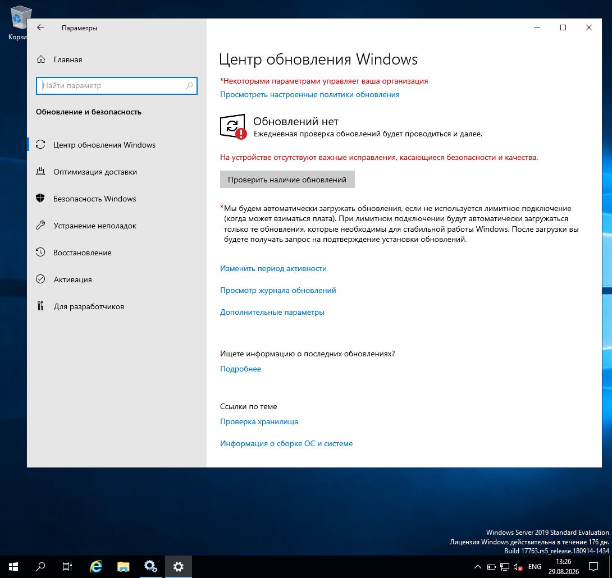

### 4. Проверка профиля пользователя по умолчанию

Открыт каталог `C:\Users\Default` — стандартный профиль пользователя. Содержит папки: Desktop, Documents, Downloads, Favorites, Links, Music, Pictures, Saved Games, Videos и файл NTUSER.DAT.

Этот профиль используется как шаблон при создании нового пользователя.

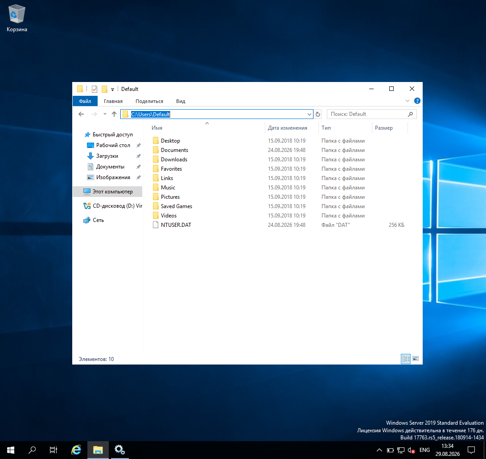

---

## 📸 Задание 2. Установка доменных служб AD DS

### 5. Установка ролей через PowerShell

Install-WindowsFeature -Name AD-Domain-Services, DNS -IncludeManagementTools

Результат:
- Success: True
- Restart Needed: No
- Exit Code: Success
- Feature Result: Доменные службы Active Directory, DNS-сервер

Роли установлены через PowerShell. После этого появились оснастки AD DS и DNS.

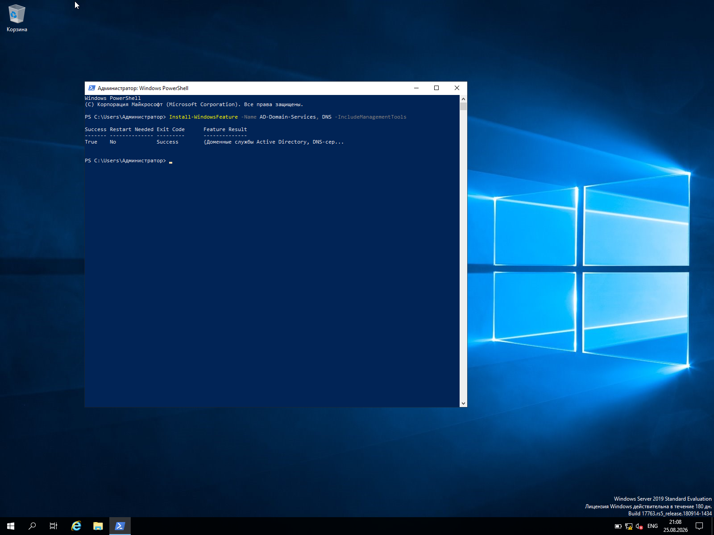

### 6. Диспетчер серверов — Локальный сервер

После установки ролей:
- Имя компьютера: **WIN-GJE0G3GES52**
- Домен: **example.com**
- Роли: **AD DS**, **DNS**
- Ethernet: 192.168.3.117, поддержка IPv6
- Брандмауэр Windows: публичный — включён

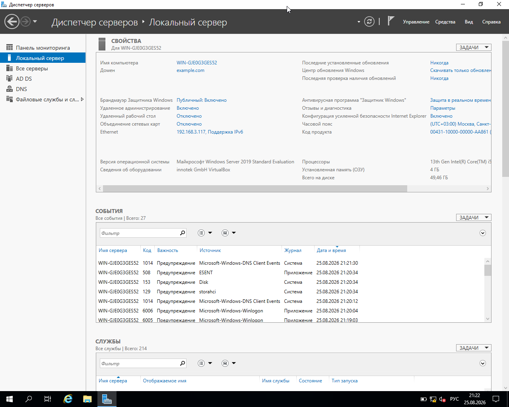

---

## 📸 Задание 3. Создание пользователя testuser

### 7. Создание учётной записи testuser

В оснастке **Active Directory — пользователи и компьютеры** → `example.com → Users` создан пользователь **testuser** (тип: Пользователь). Также видны встроенные группы: DnsAdmins, DnsUpdateProxy, Protected Users, Администраторы, Гости домена, Пользователи домена и др.

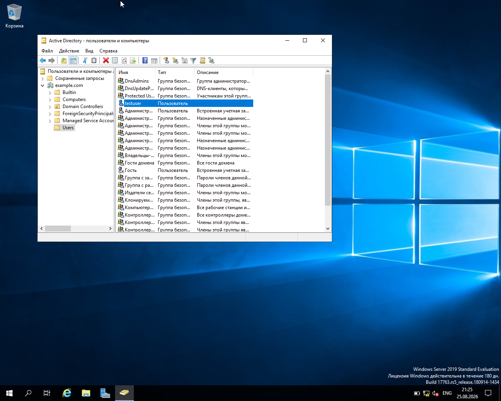

### 8. Параметры учётной записи — запрет смены пароля

В свойствах testuser → вкладка «Учётная запись»:
- **Запретить смену пароля пользователем** — включено
- Срок действия пароля не ограничен — не задано

Параметр «Запретить смену пароля» действует в паре с «Требовать смены пароля» — они взаимоисключающие. При включении одного второй автоматически снимается.

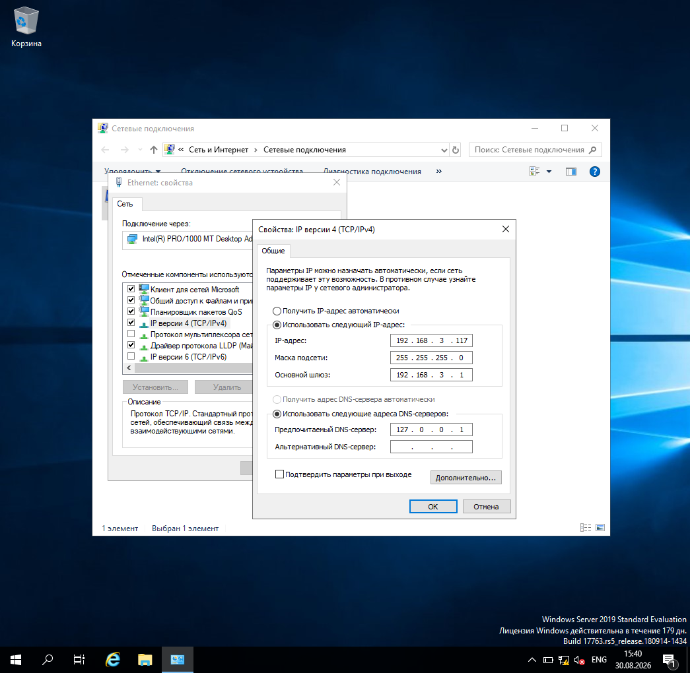

### 9. Срок действия учётной записи

В свойствах testuser → «Срок действия учётной записи»:
- Установлено: **Никогда**
- Альтернатива: «Истекает» с датой (например, 29 сентября 2026)

Срок действия определяет, до какой даты учётная запись остаётся активной. Значение «Никогда» — бессрочная учётная запись.

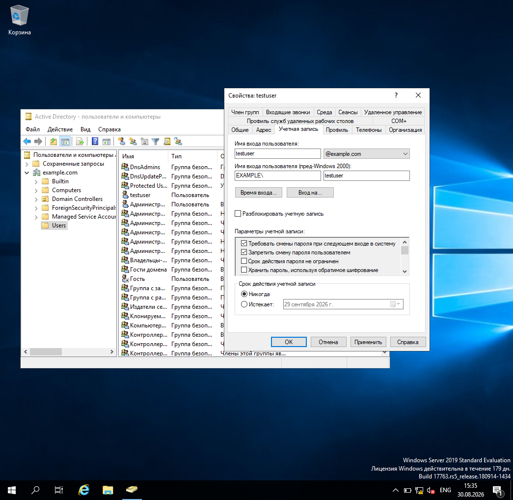

### 10. Отключение учётной записи

В свойствах testuser → галочка **«Отключить учётную запись»** — установлена.

Этот параметр полностью блокирует возможность входа в систему под данной учётной записью. В отличие от блокировки при неверных попытках входа, отключение — это ручное административное действие.

---

## 📸 Задание 4. Блокировка и разблокировка учётной записи

### 11. Экран блокировки

После нескольких неудачных попыток входа под testuser появилось сообщение:

> **Учётная запись пользователя заблокирована и не может быть использована для входа в сеть.**
> Нажмите ОК.

Блокировка произошла автоматически по политике безопасности домена (Account Lockout Policy).

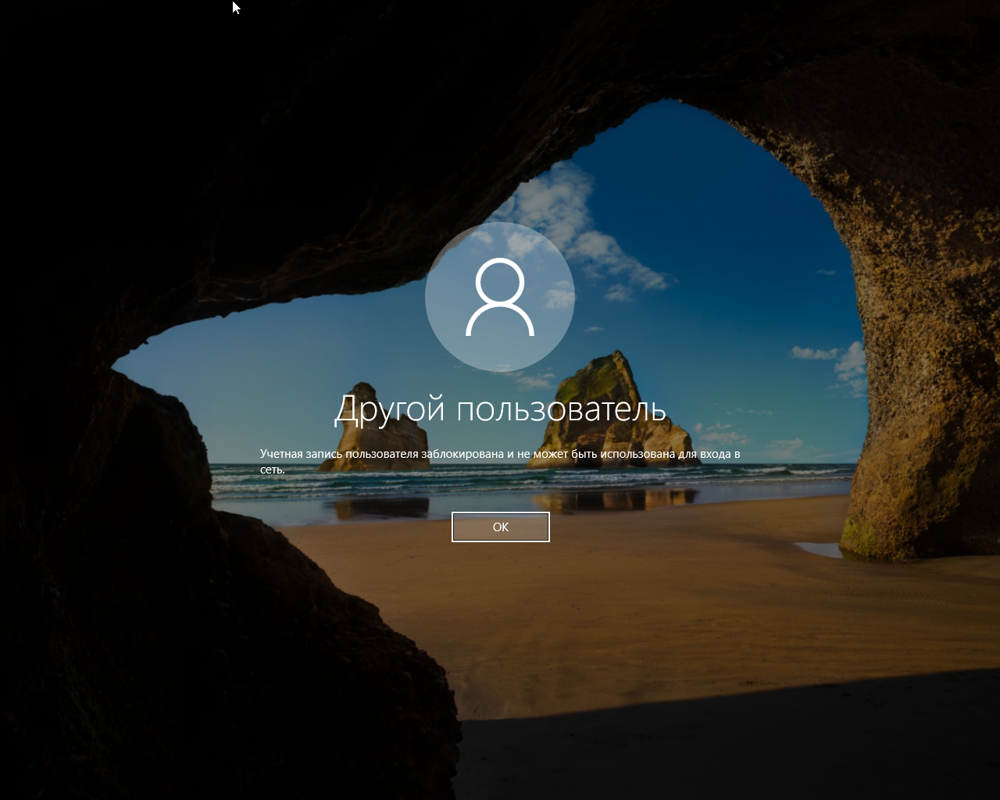

### 12. Разблокировка учётной записи

В свойствах testuser → вкладка «Учётная запись»:
- Снята галочка **«Разблокировать учётную запись»**
- После сохранения учётная запись снова активна

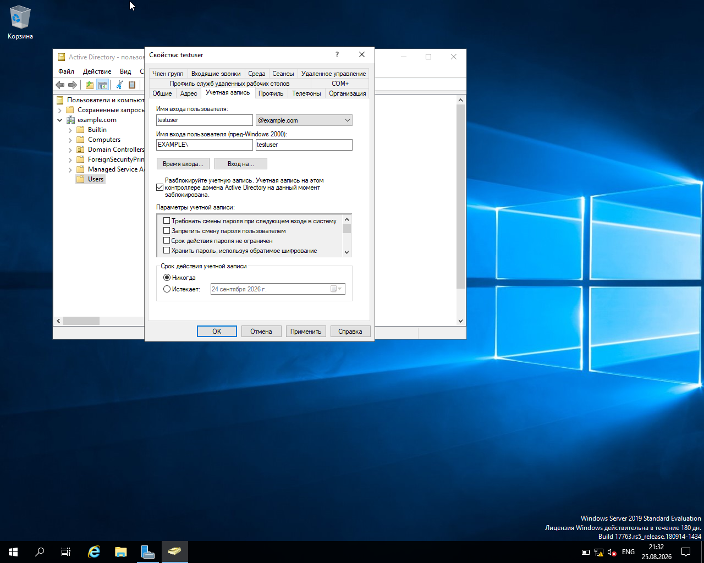

---

## 📸 Задание 5. Подключение клиента к домену

### 13. Проверка пользователя testuser

На клиентском компьютере после входа под testuser выполнено:

whoami

Результат: **example\testuser**

Это подтверждает, что вход выполнен с доменной учётной записью (не локальной).

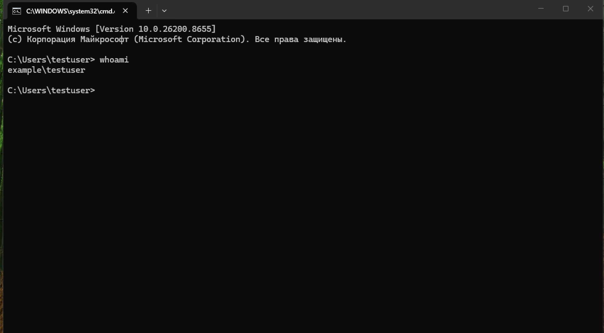

### 14. Клиент подключён к домену

В свойствах системы клиента:
- Полное имя: **WIN-A4C5EPBKH86.example.com**
- Домен: **example.com**

Компьютер успешно подключён к домену example.com.

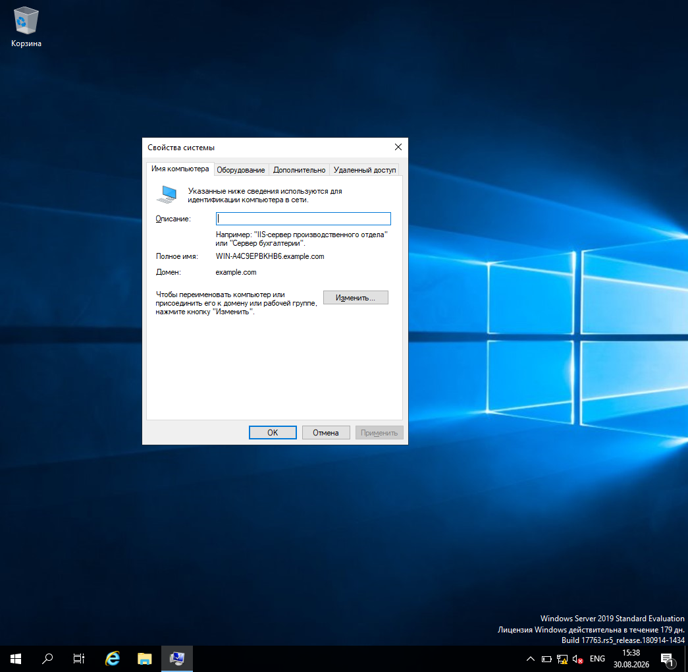

---

## 📸 Задание 6. Удаление из домена и удаление ролей

### 15. Возврат в рабочую группу

В свойствах системы → «Изменение имени компьютера или домена»:
- Выбрано: **Является членом рабочей группы**
- Рабочая группа: **WORKGROUP**
- Полное имя компьютера: WIN-RQMIHV5L4NO (без example.com)

После изменения появляется сообщение: «Чтобы изменения вступили в силу, нужно перезагрузить компьютер».

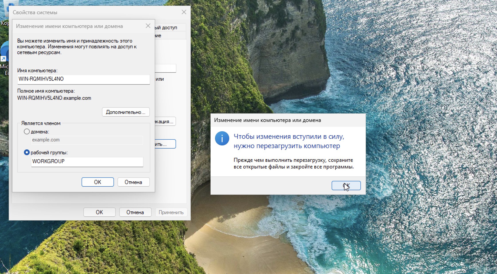

### 16. Попытка удаления роли AD DS через PowerShell

dism /online /disable-feature /featurename:AD-Domain-Services /remove /norestart

Результат:
- Система DISM: версия 10.0.17763.3406
- Версия образа: 10.0.17763.3650
- **Ошибка: 0x800f080c** — имя компонента "AD-Domain-Services" неизвестно
- Рекомендация: воспользуйтесь параметром /Get-Features

Ошибка возникла из-за того, что после понижения контроллера домена роль AD DS была удалена автоматически, и компонент уже не зарегистрирован в системе.

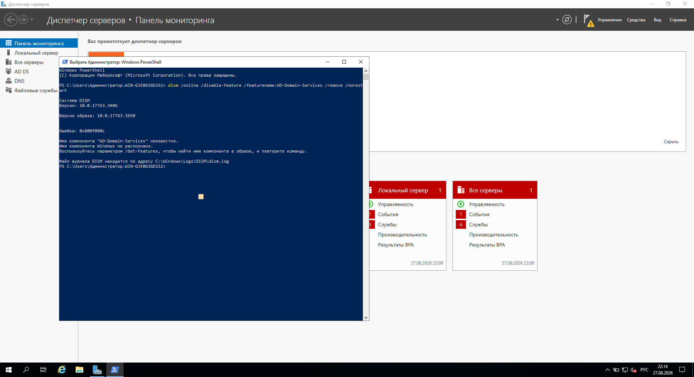

### 17. Сервер после удаления ролей

В «Диспетчере серверов» → «Локальный сервер»:
- Имя компьютера: **WIN-GJE0G3GES52**
- Рабочая группа: **WORKGROUP** (без example.com)
- Роли AD DS и DNS **отсутствуют**
- Брандмауэр: публичный — отключён
- Всего событий: 56, служб: 215

Это подтверждает, что роли Active Directory Domain Services и DNS-сервер удалены с сервера.

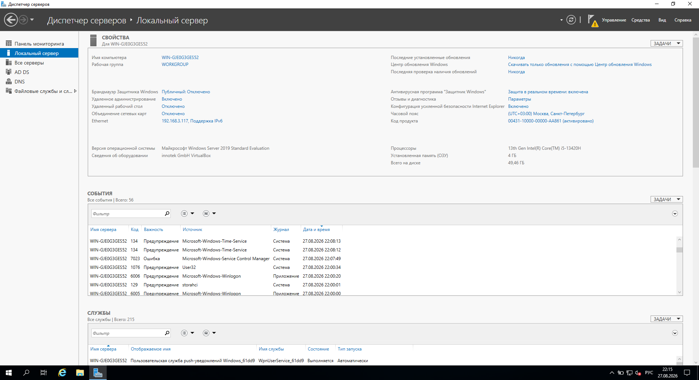

### 18. Роли и компоненты после удаления

В «Диспетчере серверов» → «Роли и компоненты»:
- Всего ролей и компонентов: 18
- Видны компоненты: XPS Viewer, Файловые службы и службы iSCSI, Совместное использование портов TCP, Службы WCF, .NET Framework 4.7

Записей о **AD DS** и **DNS-сервере** в списке нет — роли успешно удалены.

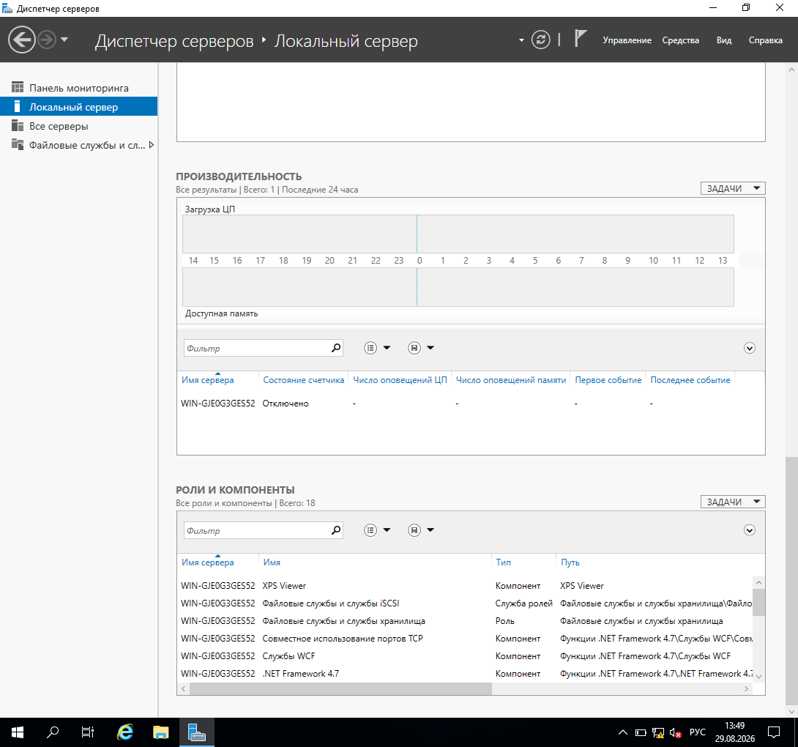

---

## 📊 Выводы
- Освоена установка ролей AD DS и DNS через PowerShell (`Install-WindowsFeature`).
- Отработано создание нового леса и домена example.com.
- Создан пользователь testuser с паролем, отвечающим требованиям политики безопасности.
- Изучены параметры учётной записи: «Требовать смену пароля», «Запретить смену пароля», «Отключить учётную запись», срок действия.
- Отработана блокировка учётной записи при неверных попытках входа и её разблокировка через оснастку AD.
- Клиентский компьютер подключён к домену example.com и вход выполнен под testuser.
- Освоено удаление компьютера из домена (возврат в WORKGROUP).
- Роли AD DS и DNS удалены с сервера, что подтверждается списком ролей.
- Понят жизненный цикл контроллера домена: установка → настройка → понижение → удаление.

## 🧠 Чему научился
- Установка ролей через PowerShell (`Install-WindowsFeature`).
- Работа с диспетчером серверов и оснасткой `dsa.msc`.
- Создание пользователей и управление их свойствами.
- Настройка политик паролей, отключения и блокировки учётных записей.
- Подключение и отключение компьютера от домена.
- Удаление ролей через PowerShell и через мастер.
- Понимание этапов развёртывания и свёртывания AD DS.
- Диагностика ошибок DISM (0x800f080c) при удалении компонентов.

## ⚠️ Особенности выполнения
- **Учётная запись testuser удалена вместе с доменом**, поэтому скриншоты параметров учётной записи предоставлены из промежуточных этапов работы. Параметры «Требовать смену пароля», «Запрет на смену пароля», «Отключить учётную запись» и срок действия поочерёдно включались, проверялись и возвращались в исходное состояние.
- **Удаление роли через DISM** завершилось ошибкой 0x800f080c — компонент уже не зарегистрирован в системе после понижения контроллера домена.
- На финальных скриншотах в разделе «Роли и компоненты» **отсутствуют записи о AD DS и DNS** — роли удалены корректно.
