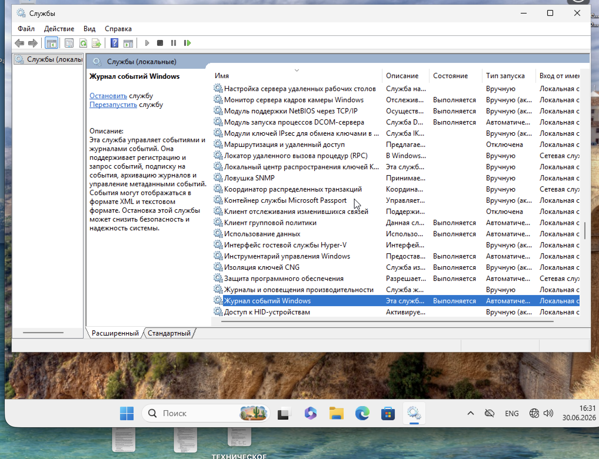
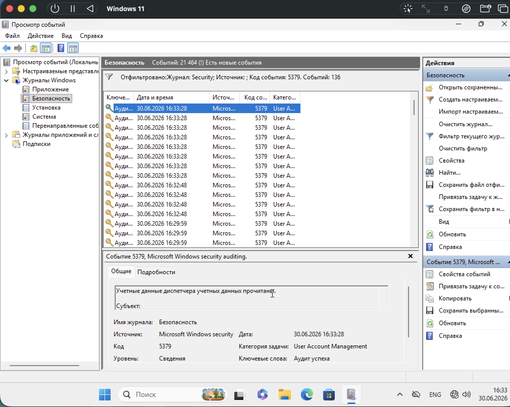
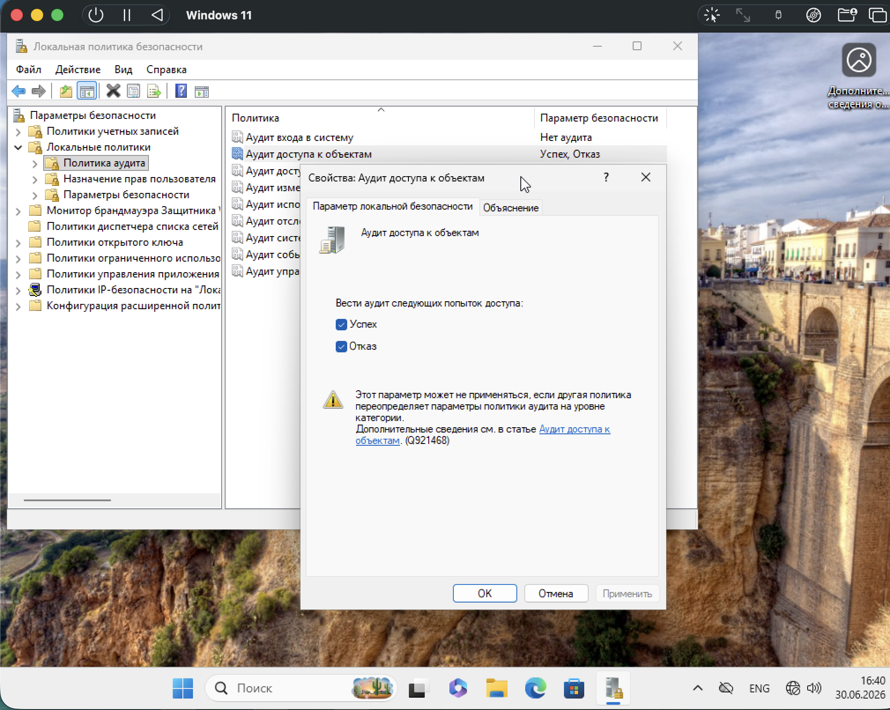
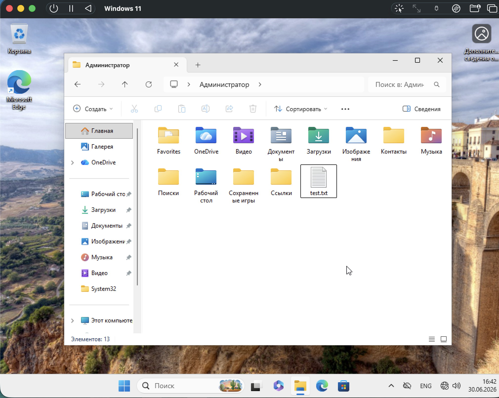
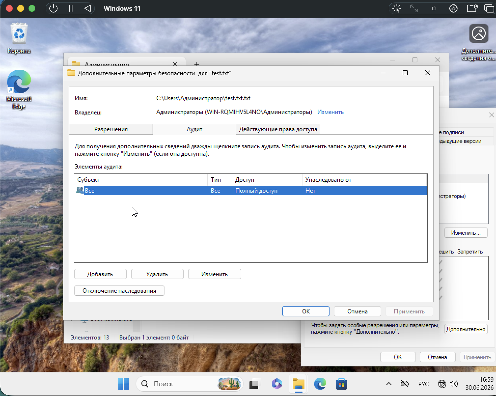

# Практическая работа: Аудит событий Windows

## 🎯 Цель работы
Закрепить на практике работу с инструментами аудита: служба «Журнал событий», аудит доступа к файлам и каталогам, расширенные политики аудита, аудит съёмных устройств, стратегия аудита организации.

## 📋 Задание
1. Убедиться, что служба «Журнал событий» запущена.
2. Проверить события с кодом 5379 в журнале «Безопасность».
3. Включить аудит доступа к файлам и каталогам.
4. Настроить аудит доступа к текстовому файлу.
5. Включить аудит отказов при входе в систему.
6. Проверить событие 4625 (неудачный вход).
7. (Доп.) Аудит съёмных устройств.
8. (Доп.) Составить план аудита для организации.

## 🛠️ Использованные инструменты
- Оснастка «Службы» (services.msc)
- Просмотр событий (eventvwr.msc)
- Локальная политика безопасности (secpol.msc)
- Свойства файла → Аудит
- Журнал «Безопасность»

---

## 📸 Задание 1. Служба «Журнал событий»

### 1. Проверка службы «Журнал событий Windows»

В оснастке `services.msc` найдена служба **«Журнал событий Windows»**:
- Состояние: **Выполняется**
- Тип запуска: **Автоматически**

Служба управляет событиями и журналами событий, поддерживает регистрацию и запрос событий, архивацию журналов.

### 2. Проверка события 5379

В «Просмотре событий» → «Журналы Windows» → «Безопасность» применён фильтр по коду события **5379**. Найдено **136 событий**.

Событие 5379 (Microsoft Windows security auditing) — «Учётные данные диспетчера учётных данных прочитаны». Это событие User Account Management, уровень «Сведения», ключевые слова «Аудит успеха».

---

## 📸 Задание 2. Аудит доступа к файлам и каталогам

### 3. Включение аудита доступа к объектам

В оснастке `secpol.msc` → «Локальные политики» → «Политика аудита» включён параметр **«Аудит доступа к объектам»** со значениями **«Успех»** и **«Отказ»**.

### 4. Создание тестового файла

В каталоге пользователя **Администратор** создан текстовый файл **test.txt**.

### 5. Настройка аудита для test.txt

В свойствах файла `test.txt` → вкладка **«Аудит»** добавлена запись:

- **Субъект:** Все
- **Тип:** Все
- **Доступ:** Полный доступ
- **Унаследовано от:** Нет

Это значит: любые попытки доступа к файлу (успешные и неудачные) будут фиксироваться в журнале «Безопасность».

---

## 📸 Задание 3. Аудит входа в систему

### 6. Включение аудита входа в систему

В оснастке `secpol.msc` → «Локальные политики» → «Политика аудита» включён параметр **«Аудит входа в систему»** со значениями **«Успех»** и **«Отказ»**.

Это позволяет фиксировать как успешные, так и неудачные попытки входа.

### 7. Проверка события 4625 (неудачный вход)

В «Просмотре событий» → «Безопасность» применён фильтр по коду **4625**. Найдено **2 события** с ключевым словом «Аудит отказа».

Событие 4625: «Учётной записи не удалось выполнить вход в систему».
- Компьютер: WIN-RQMIHV5L4NO.example.org
- Категория задачи: Logon
- Уровень: Сведения

### 8. Подробности события 4625

В деталях события:
- **Субъект:** ИД безопасности: СИСТЕМА; Имя учётной записи: WIN-RQMIHV5L4NO$
- **Домен учётной записи:** EXAMPLE
- **Код входа:** 0x3E7
- **Тип входа:** 2
- **Учётная запись, которой не удалось выполнить вход** — указана попытка с неверным паролем

Это подтверждает, что аудит отказа при входе работает корректно.

---

## 📸 Задание 4. Аудит съёмных устройств (дополнительное)

**Не выполнено по техническим причинам:** проблема с пробросом USB в виртуальную машину. Не удалось подключить съёмное устройство для проверки события 4663.

---

## 📸 Задание 5. План аудита для организации (дополнительное)

### Описание организации
- **Сфера:** торговля
- **Клиентские машины (15):**
  - 4 — бухгалтерия
  - 6 — менеджеры по продажам
  - 3 — топ-менеджмент
  - 2 — системные администраторы
- **Серверы (4):**
  - 2 контроллера домена (основной и резервный)
  - 1 веб-сервер (общедоступная информация)
  - 1 VPN-сервер (удалённый доступ)

### План аудита

**1. На всех компьютерах:**
- Неудачные попытки входа (код 4625) — для выявления попыток взлома.
- Доступ к важным файлам (код 4663) — кто читал, менял, удалял.

**2. На серверах:**
- **Контроллеры домена:** изменения в пользователях и группах (кто создавал/удалял).
- **Веб-сервер:** доступ к файлам сайта.
- **VPN-сервер:** кто подключался удалённо.

**3. Для групп сотрудников:**
- **Бухгалтерия и топ-менеджеры:** полный аудит доступа к финансовым документам и съёмным устройствам.
- **Менеджеры:** только чтение клиентской базы.
- **Системные администраторы:** аудит всех действий (вход/доступ/изменения).

**4. Хранение журналов:**
- Не менее 90 дней.
- Доступ только у администраторов.

**5. Дополнительно:**
- Настроить оповещения при 5+ неудачных входах за минуту.

---

## 📊 Выводы
- Освоена работа со службой «Журнал событий Windows».
- Отработана фильтрация событий в журнале «Безопасность» по коду (5379, 4625).
- Изучено включение аудита доступа к объектам и аудита входа в систему.
- Отработана настройка аудита для конкретного файла через вкладку «Аудит».
- Подтверждена работа события 4625 при неудачном входе.
- Составлен план аудита для организации торговли с учётом требований к группам сотрудников и серверам.
- Выявлена техническая проблема с пробросом USB для аудита съёмных устройств.

## 🧠 Чему научился
- Работа с `services.msc` для проверки службы журнала событий.
- Работа с `eventvwr.msc` для просмотра и фильтрации событий.
- Работа с `secpol.msc` для настройки политики аудита.
- Настройка аудита для конкретного файла через свойства → вкладка «Аудит».
- Анализ событий по кодам: 4625 (неудачный вход), 5379 (чтение учётных данных), 4663 (доступ к объекту).
- Составление стратегии аудита для реальной организации.

## 🔐 Практическая значимость
Аудит событий — основа мониторинга безопасности Windows. Он позволяет:
- выявлять попытки несанкционированного доступа;
- отслеживать действия пользователей с важными файлами;
- фиксировать успешные и неудачные входы;
- расследовать инциденты;
- соответствовать требованиям регуляторов (152-ФЗ, ГОСТ, PCI DSS).
