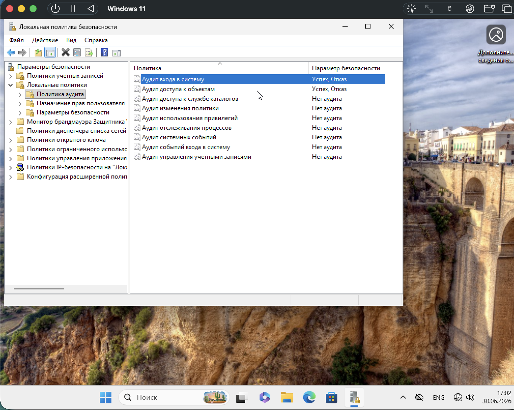
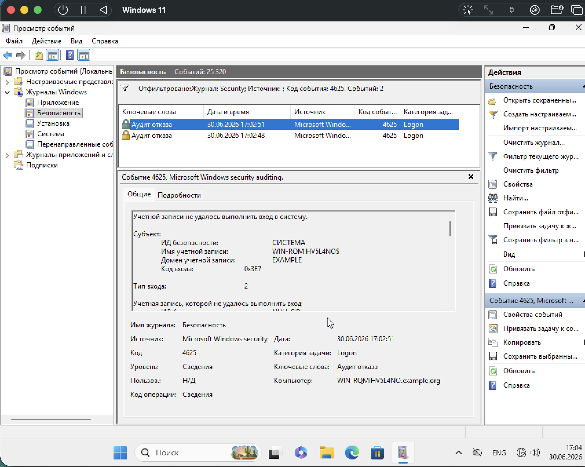

## 📸 Задание 3. Аудит входа в систему

### 6. Включение аудита входа в систему

В оснастке `secpol.msc` → «Локальные политики» → «Политика аудита» включён параметр **«Аудит входа в систему»** со значениями **«Успех»** и **«Отказ»**.

Это позволяет фиксировать как успешные, так и неудачные попытки входа.

### 7. Проверка события 4625 (неудачный вход)

В «Просмотре событий» → «Безопасность» применён фильтр по коду **4625**. Найдено **2 события** с ключевым словом «Аудит отказа».

Событие 4625: «Учётной записи не удалось выполнить вход в систему».
- Компьютер: WIN-RQMIHV5L4NO.example.org
- Категория задачи: Logon
- Уровень: Сведения

В деталях события:
- **Субъект:** ИД безопасности: СИСТЕМА; Имя учётной записи: WIN-RQMIHV5L4NO$
- **Домен учётной записи:** EXAMPLE
- **Код входа:** 0x3E7
- **Тип входа:** 2

Это подтверждает, что аудит отказа при входе работает корректно.

